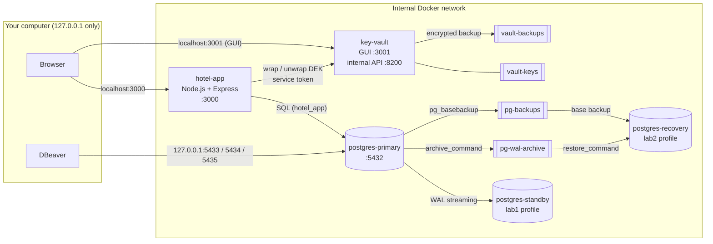
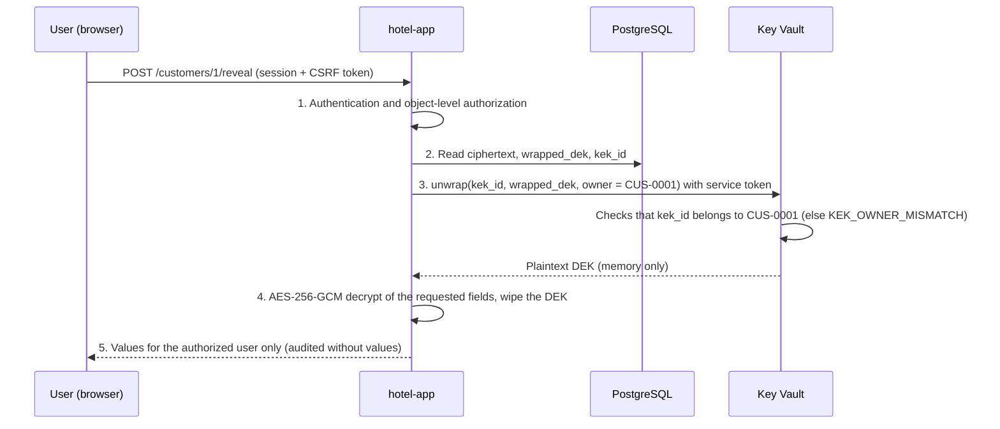
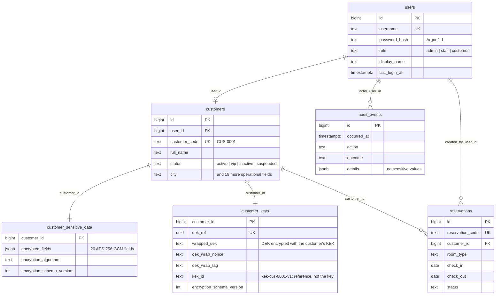
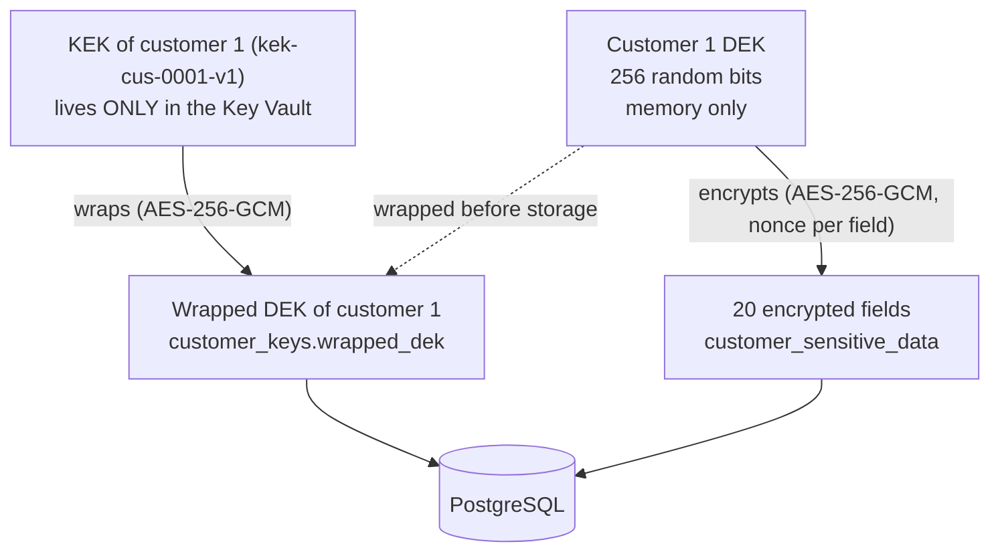

# CETYS Unit 4: High Availability and Encrypted Disaster Recovery Lab

A complete hotel management system for two cybersecurity workshops: **high availability with PostgreSQL physical replication** and **disaster recovery of encrypted data (PITR + DEK/KEK envelope encryption)**. Everything runs locally with Docker Compose.

All data is **fictional**. No name, phone number, RFC, CLABE or card number belongs to a real person or account.

---

## Table of contents

1. [Project overview](#1-project-overview)
2. [Learning objectives](#2-learning-objectives)
3. [System architecture](#3-system-architecture)
4. [Requirements and prerequisites](#4-requirements-and-prerequisites)
5. [Repository structure](#5-repository-structure)
6. [Docker images and services](#6-docker-images-and-services)
7. [Initial environment configuration](#7-initial-environment-configuration)
8. [First-run installation](#8-first-run-installation)
9. [Database migration](#9-database-migration)
10. [Initial data generation](#10-initial-data-generation)
11. [Starting the applications](#11-starting-the-applications)
12. [Default URLs and demo accounts](#12-default-urls-and-demo-accounts)
13. [Checking Docker services](#13-checking-docker-services)
14. [Inspecting PostgreSQL with DBeaver](#14-inspecting-postgresql-with-dbeaver)
15. [Exploring tables and encryption metadata](#15-exploring-tables-and-encryption-metadata)
16. [Exploring the Hotel Management Application](#16-exploring-the-hotel-management-application)
17. [Exploring the Key Vault Application](#17-exploring-the-key-vault-application)
18. [Understanding DEK and KEK](#18-understanding-dek-and-kek)
19. [Lab 1: High Availability and Failover](#19-lab-1-high-availability-and-failover)
20. [Lab 2: Disaster Recovery and Encryption](#20-lab-2-disaster-recovery-and-encryption)
21. [PostgreSQL backup and PITR procedures](#21-postgresql-backup-and-pitr-procedures)
22. [Encryption key backup and recovery](#22-encryption-key-backup-and-recovery)
23. [Troubleshooting](#23-troubleshooting)
24. [Restarting the environment](#24-restarting-the-environment)
25. [Safe cleanup and reset](#25-safe-cleanup-and-reset)
26. [Instructor notes](#26-instructor-notes)
27. [Security limitations](#27-security-limitations)

---

## 1. Project overview

The repository contains two independent Node.js applications with Bootstrap 5 web interfaces:

| Application | What it does |
|---|---|
| **Hotel Management App** (`hotel-app`) | Multi-user customer and reservation management. 150 fictional customers, each with 20 sensitive fields encrypted with AES-256-GCM and 20 operational fields without application-level encryption. Administrator, staff and customer roles with object-level authorization. Security and disaster recovery dashboards. |
| **Key Vault Management App** (`key-vault`) | Independent educational KMS. Keeps **one KEK per customer** (`kek-cus-0001-v1`, `kek-cus-0002-v1`, ...), versions and rotates them, wraps and unwraps DEKs, backs up and restores the key store, and simulates failures (including shredding one customer's KEK). It has its own administrator account. |

The infrastructure uses real **PostgreSQL 17**: physical streaming replication, `pg_basebackup`, continuous WAL archiving and Point-in-Time Recovery. None of this is simulated by copying records.

## 2. Learning objectives

After the two workshops, students will be able to:

- Explain the difference between high availability (failover) and disaster recovery (backup + PITR).
- Verify physical streaming replication and measure the real recovery time (RTO) of a manual failover.
- Promote a standby while preventing split brain.
- Create a physical backup, verify WAL archiving and restore to a named point before an accidental deletion.
- Explain envelope encryption: why PostgreSQL stores the wrapped DEK and the `kek_id` but never the KEK.
- Explain why each customer has its own KEK: rotating or destroying one customer's key (crypto-shredding) affects only that customer.
- Show that a database backup without its keys cannot be used to read encrypted data, and that keys must be backed up independently.
- Classify data (sensitive vs. operational) and observe the cost of selective encryption.
- Recognize and prevent BOLA/IDOR vulnerabilities with backend authorization.

## 3. System architecture



Key points:

- **PostgreSQL never connects to the Key Vault.** The hotel application orchestrates all encryption and decryption.
- **Every customer has its own KEK.** `customer_keys.kek_id` of customer `CUS-0001` is always `kek-cus-0001-v<N>`. The Key Vault creates that KEK the first time the customer's DEK is wrapped, and refuses to unwrap a DEK with a KEK that belongs to another customer.
- The **Key Vault cryptographic API (8200) is not published** to the host; only the GUI (3001) is, on `127.0.0.1`.
- The keys (`vault-keys`) and their backups (`vault-backups`) live in volumes **separate** from the PostgreSQL data and backups.
- The hotel application picks its PostgreSQL server from the shared file `/lab-control/db-target`. The failover and PITR scripts update it, and the application reconnects on its own in about 2 seconds.

Flow when a sensitive value is revealed:



## 4. Requirements and prerequisites

| Requirement | Details |
|---|---|
| Docker Desktop (Windows/macOS) or Docker Engine (Linux) | A recent version with **Docker Compose v2** (`docker compose version`). Give Docker at least 4 GB of RAM. |
| Git | To clone the repository. |
| Bash | Included on macOS and Linux. On Windows use **WSL2** (recommended) or **Git Bash**. |
| A modern browser | Chrome, Edge, Firefox or Safari. |
| DBeaver Community (optional but recommended) | https://dbeaver.io/download/ |
| Free ports | 3000, 3001, 5433 (and 5434, 5435 for the labs). |
| Disk | About 3 GB for images, volumes and backups. |

You do not need Node.js or PostgreSQL installed on your computer: everything runs in containers. Once the images are built, the interfaces work offline (Bootstrap and the icons are served locally).

**Windows:** clone the repository *inside* WSL2 (for example in `~/cetys`) and run every command from the Ubuntu terminal. Without WSL2, `scripts/setup-env.ps1` can generate the `.env` with PowerShell; the other scripts need Git Bash.

## 5. Repository structure

```text
cetys-unit4-disaster-recovery-lab/
├── README.md                     This guide (entry point)
├── docker-compose.yml            Services, lab1/lab2 profiles, volumes, health checks
├── .env.example                  Configuration contract (copied by setup-env.sh)
├── docker/postgres/              PostgreSQL 17 lab image
│   ├── Dockerfile
│   ├── lab-entrypoint.sh         primary / standby / recovery roles, split-brain fence
│   ├── archive-wal.sh            archive_command (never overwrites different WAL)
│   ├── lab-basebackup.sh         pg_basebackup + pg_verifybackup + catalog
│   ├── lab-prepare-recovery.sh   Prepares the PITR instance
│   └── initdb/01-lab-replication.sh
├── hotel-app/                    Hotel Management App (Express + EJS + Bootstrap 5)
│   ├── migrations/               Versioned SQL (001_schema.sql, 002_views.sql)
│   ├── src/
│   │   ├── server.js             Web server, safe automatic initialization
│   │   ├── db.js                 PostgreSQL pool with a switchable target server
│   │   ├── vaultClient.js        Key Vault internal API client
│   │   ├── crypto/envelope.js    Per-field AES-256-GCM + envelope encryption
│   │   ├── policy.js             Object-level authorization (anti BOLA/IDOR)
│   │   ├── fields.js             Classification: 20 sensitive + 20 operational
│   │   ├── data/generator.js     Reproducible fictional data
│   │   ├── migrate.js, seed.js   Idempotent migrations and seed
│   │   ├── routes/, services/    Routes and logic
│   │   └── cli/                  migrate.js, seed.js, verify.js
│   ├── views/                    EJS templates
│   ├── public/                   Custom CSS and JS
│   └── test/                     Unit tests
├── key-vault/                    Key Vault Management App
│   ├── src/store.js              KEK store, wrap/unwrap, backups, simulations
│   ├── src/api.js                Internal API :8200 (service token)
│   ├── src/gui.js                Administration GUI :3001
│   ├── src/cli/admin.js          Internal CLI (backups, access, rotation, shred)
│   ├── views/, public/, test/
├── scripts/                      Lab operations (see table below)
├── docs/
│   ├── lab1-high-availability.md
│   ├── lab2-encrypted-recovery.md
│   ├── instructor-guide.md
│   └── sql/dbeaver-queries.sql
└── test-results/                 Output of ./scripts/test-all.sh (git-ignored)
```

| Script | Purpose |
|---|---|
| `setup-env.sh` / `setup-env.ps1` | Generates `.env` with random secrets (never overwrites without confirmation). |
| `migrate.sh` | Creates or updates the schema, indexes, constraints, views and roles. Idempotent. |
| `seed.sh` | Initializes the Key Vault (if it never was) and creates the 150 customers, each with its own KEK. Idempotent. |
| `verify-setup.sh` | PASS/FAIL checks for the whole installation. |
| `start.sh [base\|lab1]` | Starts the environment (with the standby for `lab1`). |
| `stop.sh` | Stops containers without deleting volumes. |
| `status.sh` | Status of containers, app server, replication, WAL, backups and keys. |
| `backup.sh db\|keys\|all\|list` | Physical PostgreSQL backup or independent KEK backup. |
| `restore.sh pitr\|keys` | PITR into a separate instance, or KEK restore. |
| `lab1-failover.sh` | Promotes the standby with split-brain protection. |
| `lab2-recovery-point.sh` | Creates a named restore point and forces it to be archived. |
| `lab2-simulate-deletion.sh` | Simulated accidental deletion (lab only). |
| `switch-db.sh` | Switches the PostgreSQL server used by the app. |
| `reset-lab.sh lab1\|lab2\|all` | Controlled reset with explicit confirmation. |
| `test-all.sh` | Full integration tests in an isolated Docker project. |

## 6. Docker images and services

| Service | Image | Port on your machine | Profile | Role |
|---|---|---|---|---|
| `postgres-primary` | `cetys-dr/postgres:17` | `127.0.0.1:5433` | (always) | Primary with `wal_level=replica` and WAL archiving |
| `key-vault` | `cetys-dr/key-vault:1.0` | `127.0.0.1:3001` (GUI only) | (always) | Educational KMS; internal API at `key-vault:8200` |
| `hotel-app` | `cetys-dr/hotel-app:1.0` | `127.0.0.1:3000` | (always) | Hotel application |
| `postgres-standby` | `cetys-dr/postgres:17` | `127.0.0.1:5434` | `lab1` | Streaming standby (pg_basebackup -R) |
| `postgres-recovery` | `cetys-dr/postgres:17` | `127.0.0.1:5435` | `lab2` | Disposable PITR instance |

Named volumes (prefix `cetys-disaster-recovery_`):

| Volume | Contents |
|---|---|
| `pg-primary-data` | Primary data |
| `pg-standby-data` | Standby data |
| `pg-recovery-data` | Recovered instance data (disposable) |
| `pg-wal-archive` | Continuously archived WAL |
| `pg-backups` | `pg_basebackup` physical backups and their catalog |
| `vault-keys` | KEK material (`keystore.json`), Key Vault state and log |
| `vault-backups` | Encrypted, independent KEK backups |
| `lab-control` | Control files: target server, fence, restore points, logs |

A normal startup never deletes volumes, regenerates keys or resets the database.

## 7. Initial environment configuration

Every variable is documented in `.env.example`. The `./scripts/setup-env.sh` script:

1. Checks whether `.env` already exists and **does not overwrite it** unless you type `OVERWRITE` (it saves a `.env.bak-...` copy).
2. Copies `.env.example` and replaces every `CHANGE_ME` with a random 128-bit local secret.
3. Sets `.env` to mode `600`.
4. Prints the configuration without showing passwords or tokens.

Main variables:

| Variable | Default | Use |
|---|---|---|
| `COMPOSE_PROJECT_NAME` | `cetys-disaster-recovery` | Prefix for containers and volumes |
| `POSTGRES_DB` | `hotel_lab` | Database |
| `POSTGRES_USER` / `POSTGRES_PASSWORD` | `hotel_admin` / generated | Server administrator (migrations, scripts) |
| `POSTGRES_HOST_PORT` | `5433` | Primary port on `127.0.0.1` |
| `POSTGRES_STANDBY_HOST_PORT` | `5434` | Standby port |
| `POSTGRES_RECOVERY_HOST_PORT` | `5435` | PITR instance port |
| `REPLICATION_USER` / `REPLICATION_PASSWORD` | `replicator` / generated | Physical replication role |
| `DB_HOST` / `DB_PORT` | `postgres-primary` / `5432` | Initial app server **inside Docker** |
| `DB_USER` / `DB_PASSWORD` | `hotel_app` / generated | Application role (not a superuser) |
| `DB_READER_USER` / `DB_READER_PASSWORD` | `lab_reader` / generated | Read-only account for DBeaver |
| `HOTEL_APP_PORT` / `KEY_VAULT_APP_PORT` | `3000` / `3001` | GUI ports |
| `KEY_VAULT_URL` | `http://key-vault:8200` | Key Vault internal API (not published) |
| `KEY_VAULT_SERVICE_TOKEN` | generated | Service-to-service authentication |
| `HOTEL_SESSION_SECRET` / `VAULT_SESSION_SECRET` | generated | Session cookie signing |
| `VAULT_ADMIN_USER` / `VAULT_ADMIN_PASSWORD` | `vault_admin` / `VaultAdmin2026!` | Key Vault GUI administrator |
| `VAULT_BACKUP_PASSPHRASE` | generated | Encrypts the KEK backups |
| `HOTEL_DEMO_*_PASSWORD` | `Admin2026!`, `Staff2026!`, `Customer2026!` | Passwords of the fictional accounts |
| `AUTO_INIT` | `true` | The app applies migrations and seed **only** if the database is empty and unmarked |
| `LAB_MODE` | `true` | Shows lab hints on the sign-in pages |

**Hostname inside Docker vs. hostname from your computer:**

- Containers talk to each other by service name on the internal network: the app uses `postgres-primary:5432`.
- From your computer (DBeaver, terminal) that name does not exist. Use `127.0.0.1` and the published port: `127.0.0.1:5433`.
- PostgreSQL is published on `127.0.0.1` only, never on all network interfaces.

## 8. First-run installation

Run every command from the **repository root**.

```bash
git clone https://github.com/lccjavo/cetys-unit4-disaster-recovery-lab.git
cd cetys-unit4-disaster-recovery-lab
```

### Step 1: Build the images

```bash
docker compose build
```

This works even before `.env` exists (Compose uses fallback values and the build needs no secrets). The first time it takes 2 to 5 minutes.

### Step 2: Generate the environment file

```bash
./scripts/setup-env.sh
```

Expected result: `File .env generated successfully (8 random secrets)` and a summary of hosts, ports and URLs. To see the passwords: `cat .env`.

### Step 3: Start the infrastructure dependencies

```bash
docker compose up -d postgres-primary key-vault
```

PostgreSQL initializes itself (creates the `hotel_lab` database and the replication role). The Key Vault becomes ready to receive requests. Check that both show `healthy`:

```bash
docker compose ps
```

### Step 4: Initialize the schema

```bash
./scripts/migrate.sh
```

See [section 9](#9-database-migration).

### Step 5: Initialize keys and data

```bash
./scripts/seed.sh
```

See [section 10](#10-initial-data-generation). Expected end of the output:

```text
[seed] Decryption check: 150/150 customers decrypted with their own KEK (all 20 fields readable)
[seed] Customer KEKs backed up: kek-backup-...-auto-seed.json (150 KEKs)
...
[seed] Wrapped DEKs: 150, each with its own customer KEK (150 KEKs: kek-cus-0001-v1 ... kek-cus-0150-v1)
```

### Step 6: Start the complete application

```bash
docker compose up -d
```

### Step 7: Verify everything

```bash
docker compose ps
./scripts/verify-setup.sh
```

Expected final line: `RESULT: PASS (...)`.

**Instructor shortcut:** on a fresh environment, `docker compose up -d --build` does all of the above automatically (the app applies migrations and generates the data when it finds an empty database). The step-by-step flow is still recommended in class, because it lets students observe each stage.

## 9. Database migration

`./scripts/migrate.sh` runs `hotel-app/src/cli/migrate.js` in a temporary container with the administrator account:

1. Creates or updates the `hotel_app` (application) and `lab_reader` (read-only, `default_transaction_read_only = on`) roles with the passwords from `.env`.
2. Applies, in order, the `hotel-app/migrations/NNN_*.sql` files not yet recorded in `schema_migrations`.
3. Re-applies privileges (`GRANT`) to cover new tables.

It is **idempotent**: running it again prints `New migrations: 0` and deletes nothing. Expected output:

```text
[migrate] Role hotel_app: created; role lab_reader (read-only): created
[migrate] Applied 001_schema.sql
[migrate] Applied 002_views.sql
[migrate] New migrations: 2; already applied: 0; tables in public: 9
OK  Migrations completed.
```

## 10. Initial data generation

`./scripts/seed.sh`:

1. Checks PostgreSQL and the Key Vault.
2. If the Key Vault was **never** initialized, initializes its key store (and an automatic backup). If it already has KEKs, it keeps them.
3. If the Key Vault lost its KEKs, it **stops** and reports it: it never generates incompatible replacement keys.
4. Generates 150 reproducible fictional customers (the same seed always produces the same profiles), 3 staff accounts and 304 reservations.
5. For each customer: generates a random 256-bit DEK, encrypts the 20 sensitive fields with AES-256-GCM (a fresh 96-bit nonce per field), and asks the Key Vault to wrap the DEK **with that customer's own KEK**. The Key Vault creates the customer's KEK on this first wrap (`CUS-0001` gets `kek-cus-0001-v1`) and returns its `kek_id`. **Only then** does the seed run the `INSERT`, storing that `kek_id` in `customer_keys`.
6. Checks that exactly 150 customers exist, that there are 150 distinct KEKs (one per customer), and that all 150 decrypt with their own KEK and their 20 fields.
7. Backs up the 150 new customer KEKs (`kek-backup-...-auto-seed.json`) and writes the `lab_metadata.seed_completed_at` marker.

If the marker exists (including on a database restored with PITR), the seed does nothing: `The database was already initialized ... Nothing is regenerated.`

Fictional data used:

| Data | Fictional format |
|---|---|
| Phone numbers | The `555` segment (MX) and `555-01xx` (reserved for fiction in North America) |
| Emails | The reserved `.test` domain |
| Cards | Public **test** numbers (for example `4111 1111 1111 1111`); they cannot be used for payments. **No CVV/CVC is stored.** |
| RFC (Mexican tax ID) | RFC structure with a homoclave ending in `LB` (lab) |
| CLABE (Mexican bank account) | 18 digits with bank code `999` (non-existent) and a computed check digit |
| Passport / bank account | `LAB` prefix |
| Accompanying children | Invented names tagged `fictional` |

## 11. Starting the applications

```bash
docker compose up -d          # base environment: primary + Key Vault + hotel
./scripts/start.sh            # same, waiting until everything is healthy
./scripts/start.sh lab1       # also the Lab 1 standby
```

The Lab 2 `postgres-recovery` instance is started by `./scripts/restore.sh pitr`; do not start it manually.

## 12. Default URLs and demo accounts

| Application | URL |
|---|---|
| Hotel Management | http://localhost:3000 |
| Key Vault | http://localhost:3001 |

Hotel accounts (all fictional):

| Role | Username | Password | Can |
|---|---|---|---|
| Administrator | `admin@hotel-lab.test` | `Admin2026!` | Everything: directory, reveal all 20 fields, Security, Recovery, Accounts |
| Staff | `frontdesk@hotel-lab.test` | `Staff2026!` | Directory and reservations; reveal only contact, guests and emergency fields |
| Staff | `concierge@hotel-lab.test` | `Staff2026!` | Same as front desk |
| Customer | `customer001@hotel-lab.test` | `Customer2026!` | Only their own profile (Ana Lucía Martínez Ruiz, CUS-0001) and reservations |
| Customer | `customer002@hotel-lab.test` ... `customer150@hotel-lab.test` | `Customer2026!` | Only their own profile |

Key Vault account (separate):

| Username | Password |
|---|---|
| `vault_admin` | `VaultAdmin2026!` (variable `VAULT_ADMIN_PASSWORD` in `.env`) |

## 13. Checking Docker services

```bash
docker compose ps                    # status and health checks
./scripts/status.sh                  # lab summary
docker compose logs -f hotel-app     # app logs (Ctrl+C to exit)
docker compose logs key-vault
docker compose logs postgres-primary
```

Expected state in the base environment: `postgres-primary`, `key-vault` and `hotel-app` all `Up ... (healthy)`.

## 14. Inspecting PostgreSQL with DBeaver

### Step 1: Install DBeaver

Download DBeaver Community from https://dbeaver.io/download/ and install it. You can use any other PostgreSQL-compatible client (pgAdmin, DataGrip, `psql`) if you prefer; the connection details are the same.

### Step 2: Create a PostgreSQL connection

1. In DBeaver: **Database > New Database Connection** (or the plug icon with a + sign).
2. Choose **PostgreSQL** and click **Next**.
3. Enter:

| Field | Value |
|---|---|
| Host | `127.0.0.1` |
| Port | `5433` |
| Database | `hotel_lab` |
| Authentication | Database Native |
| Username | `lab_reader` |
| Password | the value of `DB_READER_PASSWORD` in `.env` |

To get the password, run this from the repository root:

```bash
grep DB_READER_PASSWORD .env
```

Copy everything after the `=` sign. (On Windows with WSL2 you can also open the file with `notepad.exe .env`.)

Remember: do **not** use `postgres-primary` as the host in DBeaver. That name only exists inside the Docker network. From your computer the server is `127.0.0.1:5433`.

### Step 3: Test connectivity

1. Click **Test Connection...**.
2. If DBeaver asks to download the PostgreSQL driver, click **Download**. If you are offline at that moment, connect once to download it; after that it is no longer needed.
3. You should see **Connected**. Click **Finish**.

If it fails, check that Docker and PostgreSQL are running:

```bash
docker compose ps postgres-primary
./scripts/verify-setup.sh
```

### Step 4: Navigate the database

In the **Database Navigator** panel: `hotel_lab > Databases > hotel_lab > Schemas > public > Tables`. Open each one (double-click, **Data** tab):

| Table | What to look at |
|---|---|
| `users` | Accounts and the Argon2id password hashes |
| `customers` | The 20 operational fields in regular columns |
| `customer_sensitive_data` | The `encrypted_fields` column (JSONB) with `ciphertext`, `nonce` and `tag` per field |
| `customer_keys` | `wrapped_dek`, `dek_wrap_nonce`, `dek_wrap_tag`, `kek_id` |
| `reservations` | Fictional reservations |
| `audit_events` | Audit log (never contains sensitive values) |

### Step 5: Run SQL queries

Open an SQL editor (**SQL Editor > New SQL script**, or `Ctrl+]`) and run with `Ctrl+Enter`. Every query in this section is in `docs/sql/dbeaver-queries.sql`, and the automated tests run them as `lab_reader`.

1. Count users:

```sql
SELECT count(*) AS total_users FROM users;
SELECT role, count(*) AS users FROM users GROUP BY role ORDER BY role;
```

Expected: 153 users (1 admin, 2 staff, 150 customer).

2. List 10 customers:

```sql
SELECT id, customer_code, full_name, status, loyalty_tier
FROM customers
ORDER BY id
LIMIT 10;
```

3. City and country:

```sql
SELECT country, city, count(*) AS customers
FROM customers
GROUP BY country, city
ORDER BY customers DESC, city;
```

4. Encrypted phone number of customer 1:

```sql
SELECT c.id,
       c.full_name,
       s.encrypted_fields -> 'phone_number' ->> 'ciphertext' AS phone_ciphertext,
       s.encrypted_fields -> 'phone_number' ->> 'nonce'      AS phone_nonce,
       s.encrypted_fields -> 'phone_number' ->> 'tag'        AS phone_tag,
       s.encrypted_fields -> 'phone_number' ->> 'alg'        AS algorithm
FROM customers c
JOIN customer_sensitive_data s ON s.customer_id = c.id
WHERE c.id = 1;
```

5. An encrypted financial field:

```sql
SELECT c.id,
       c.customer_code,
       s.encrypted_fields -> 'card_number' ->> 'ciphertext' AS card_ciphertext,
       length(decode(s.encrypted_fields -> 'card_number' ->> 'ciphertext', 'base64')) AS card_bytes,
       s.encrypted_fields -> 'clabe' ->> 'ciphertext' AS clabe_ciphertext
FROM customers c
JOIN customer_sensitive_data s ON s.customer_id = c.id
WHERE c.id = 1;
```

6. Every customer has its own KEK (`kek_id` = `kek-<customer code>-v<N>`):

```sql
SELECT c.id AS customer_id, c.customer_code, k.kek_id, k.dek_ref
FROM customer_keys k
JOIN customers c ON c.id = k.customer_id
ORDER BY c.id
LIMIT 10;

SELECT count(*) AS customers,
       count(DISTINCT k.kek_id) AS distinct_keks,
       count(*) FILTER (WHERE k.kek_id LIKE 'kek-' || lower(c.customer_code) || '-v%') AS on_their_own_kek
FROM customer_keys k
JOIN customers c ON c.id = k.customer_id;
```

Expected: `CUS-0001 | kek-cus-0001-v1`, `CUS-0002 | kek-cus-0002-v1`, ... and `150 | 150 | 150`.

7. Inspect a wrapped DEK:

```sql
SELECT customer_id,
       dek_ref,
       wrapped_dek,
       length(decode(wrapped_dek, 'base64')) AS wrapped_bytes,
       dek_wrap_nonce,
       dek_wrap_tag,
       kek_id,
       wrap_algorithm,
       encryption_schema_version
FROM customer_keys
WHERE customer_id = 1;
```

`wrapped_bytes` is 32: the 256 bits of the DEK, but encrypted with the KEK of customer 1 (`kek-cus-0001-v1`).

8. User, customer, encrypted data and key relationship:

```sql
SELECT
    u.id AS user_id,
    u.username,
    c.id AS customer_id,
    c.full_name,
    c.city,
    c.country,
    k.kek_id,
    LEFT(s.encrypted_fields -> 'phone_number' ->> 'ciphertext', 32) AS encrypted_phone_preview,
    LEFT(k.wrapped_dek, 32) AS wrapped_dek_preview
FROM users u
JOIN customers c ON c.user_id = u.id
JOIN customer_sensitive_data s ON s.customer_id = c.id
JOIN customer_keys k ON k.customer_id = c.id
ORDER BY c.id
LIMIT 10;
```

9. Count reservations:

```sql
SELECT count(*) AS total_reservations FROM reservations;
SELECT status, count(*) AS reservations FROM reservations GROUP BY status ORDER BY status;
```

Expected after the seed: 304.

10. Ciphertext is present even when the Key Vault is unavailable:

```sql
SELECT count(*) AS encrypted_profiles,
       count(*) FILTER (WHERE encrypted_fields ? 'phone_number') AS with_encrypted_phone,
       min((SELECT count(*) FROM jsonb_object_keys(encrypted_fields))) AS min_fields,
       max((SELECT count(*) FROM jsonb_object_keys(encrypted_fields))) AS max_fields
FROM customer_sensitive_data;
```

Expected: 150, 150, 20, 20, whether the Key Vault is running or not.

Extra query: PostgreSQL has no column holding KEKs, only the `kek_id` reference:

```sql
SELECT table_name, column_name, data_type
FROM information_schema.columns
WHERE table_schema = 'public' AND (column_name ILIKE '%kek%' OR column_name ILIKE '%dek%')
ORDER BY table_name, column_name;
```

### Step 6: Compare encrypted and decrypted values

1. In DBeaver run query 4 and note the beginning of `phone_ciphertext` for customer 1.
2. At http://localhost:3000 sign in as `admin@hotel-lab.test` and open **Customers > CUS-0001**.
3. Open the **Personal information** tab and click **Reveal sensitive information**.
4. Look at the decrypted phone number (for example `+52 664 555 ...`). It is the same value that DBeaver only shows as base64 ciphertext.
5. Open the **Encryption details** tab and find the `kek_id`: `kek-cus-0001-v1`, the KEK of this customer only.
6. Open http://localhost:3001, sign in as `vault_admin` and go to **KEKs**. Filter by `CUS-0001`.
7. Confirm that `kek-cus-0001-v1` exists, with its creation date and fingerprint. Filter by `CUS-0002`: it has a different KEK with a different fingerprint.

Why does PostgreSQL store the wrapped DEK but not the KEK? If someone steals the database or a backup, they get ciphertext and wrapped DEKs. To open a DEK they also need the KEK, which lives in another system with separate access control. Separating the key from the data is the whole point of envelope encryption. Giving each customer its **own** KEK also limits the blast radius: one customer's key can be rotated, revoked or destroyed without touching anyone else.

### Step 7: Inspect encryption during a Key Vault failure

1. Stop the Key Vault (PostgreSQL keeps running):

   ```bash
   docker compose stop key-vault
   ```

2. In DBeaver run queries 4 and 10 again: the ciphertext is still there (150 profiles, 20 fields).
3. In the hotel app open profile CUS-0001: the operational data is visible, the **Key Vault unavailable** warning appears, and **Reveal** answers `[VAULT_UNAVAILABLE]`.
4. Bring the service back and reveal again:

   ```bash
   docker compose start key-vault
   ```

## 15. Exploring tables and encryption metadata



| Table | Description |
|---|---|
| `users` | One row per account. `role` controls access. |
| `customers` | Customer profile: basic identity (`customer_code`, `full_name`, `status`) and the **20 operational fields**. |
| `customer_sensitive_data` | The **20 encrypted sensitive fields**. Each JSONB key has `alg`, `v`, `nonce`, `ciphertext` and `tag`. |
| `customer_keys` | The customer's DEK **wrapped** by the Key Vault with that customer's own KEK, and its `kek_id` (`kek-cus-0001-v1`). |
| `reservations` | Reservations (ID, customer, room type, dates, status). |
| `audit_events` | Audit log: sign-ins, reveals (field names only), denied attempts. |
| `recovery_verifications` | Results of the **Verify recovery** button. |
| `lab_metadata` | Seed marker (`seed_completed_at`). |
| `schema_migrations` | Applied migrations. |
| Views `v_customer_encryption_overview`, `v_kek_usage` | Encryption metadata summaries for class. |

The 20 sensitive fields (`encrypted_fields`): `phone_number`, `personal_email`, `home_address`, `billing_address`, `date_of_birth`, `tax_id_rfc`, `passport_number`, `card_number`, `cardholder_name`, `card_expiration`, `bank_account_number`, `clabe`, `annual_income_range`, `outstanding_balance`, `employer_name`, `company_legal_name`, `room_guests`, `accompanying_children`, `emergency_contact_name`, `emergency_contact_phone`.

The 20 operational fields (`customers` columns): `display_nickname`, `city`, `country`, `preferred_language`, `time_zone`, `preferred_currency`, `preferred_room_category`, `preferred_bed_type`, `preferred_floor`, `preferred_room_view`, `preferred_pillow_type`, `preferred_checkin_time`, `preferred_checkout_time`, `breakfast_preference`, `parking_required`, `wifi_usage_preference`, `newsletter_opt_in`, `loyalty_tier`, `preferred_contact_channel`, `favorite_amenity`.

The operational fields are **lower-sensitivity for this educational scenario**, not public information or legally non-personal data. That is why they are still protected by authentication and authorization; they just do not use application-level encryption. This contrast supports a discussion about data classification and the cost of encryption (the **Security and encryption** page compares the average size of both).

## 16. Exploring the Hotel Management Application

URL: **http://localhost:3000**. Sign in as `admin@hotel-lab.test` / `Admin2026!`.

### Dashboard

The home page shows:

- **Total users** (153: 150 customers + 3 staff) and **Reservations** (304).
- **Encrypted profiles** and wrapped DEKs (150).
- **Customer KEKs** (150: one per customer) and the Key Vault status.
- **PostgreSQL** card: connectivity, target server, `cluster_name` (`pg-primary`), role (primary/standby), version, timeline and `system_identifier`.
- **Key Vault** card: connectivity, key store status, customers with their own KEK, KEK versions and key access.
- **Recent activity** (audit log).
- **Connection incidents** detected by the app, with their duration (useful for measuring RTO).

In the top bar, the **DB** and **Key Vault** badges show the status at all times.

### Customers

1. Open **Customers** in the navigation bar.
2. Search for `Martinez` (search ignores accents) or `CUS-0001`.
3. Filter by **Country**, **City** or **Status**; sort by clicking the headers; move with the pagination.
4. Click the eye icon for a **preview**, or **Profile** to open the details.
5. **Overview** and **Preferences** show the operational data (no application encryption).
6. Open **Personal information**: values appear masked (`••••••••••`).
7. Click **Reveal sensitive information**: the server checks your role, asks the Key Vault to unwrap the DEK and decrypts. You will see the fictional phone, email, address, RFC and passport, and the KEK used (`kek-cus-0001-v1`).
8. Open **Financial information** and reveal the test card, the fictional CLABE, income and balance.
9. **Family and guests** shows fictional guests and children; **Reservations** shows the history.
10. Open **Encryption details**: `dek_ref`, `kek_id`, wrapped DEK, wrapping nonce and tag, and a table with each field's nonce, tag and ciphertext. DEKs and KEKs are never shown in plaintext.

Try the authorization: sign in as `frontdesk@hotel-lab.test` and open CUS-0001. Staff can reveal the phone and email but see **Restricted for your role** on the financial fields. Sign in as `customer001@hotel-lab.test` and try to open http://localhost:3000/customers/2: you get **Access denied (403)**, and the attempt is recorded in the audit log.

### New customer

**Customers > New customer** groups the fields into tabs. **Generate fictional data** fills in the form. On save, the app creates a new DEK, encrypts the 20 fields, asks the Key Vault to wrap the DEK with a **new KEK for this customer** (for example `kek-cus-0151-v1`, backed up automatically a moment later) and redirects to the new customer's **Encryption details**. If the Key Vault is unavailable, the customer is **not** saved (sensitive data is never stored unencrypted).

### Reservations

1. Open **Reservations > New reservation**.
2. Choose a customer, room type, guests and dates, and click **Create reservation**.
3. You will see the message `Reservation RES-00305 created...`.
4. Confirm the change in DBeaver:

   ```sql
   SELECT id, reservation_code, customer_id, room_type, check_in, check_out, status
   FROM reservations ORDER BY id DESC LIMIT 5;
   ```

Pending or confirmed reservations can be cancelled (with a confirmation dialog). A customer only sees and creates their own reservations, even if they tamper with the URL parameters.

### Security and encryption (administrator)

Shows whether the fields are encrypted, unique DEKs, Key Vault status, and each customer's `kek_id` compared with the Key Vault: on its own **active** KEK, on its own **retired** KEK, KEK **missing** from the Key Vault, or (never expected) a KEK of **another customer**. Also cryptographic parameters, encrypted vs. operational size, and a sample of what PostgreSQL actually stores. The **Re-wrap DEKs with each customer's active KEK** button moves every DEK from a retired version to its own customer's active version (`kek-cus-0001-v1` -> `kek-cus-0001-v2`) without the DEK ever leaving the Key Vault.

### Recovery (administrator)

The **Recovery** page (http://localhost:3000/dr) shows:

- The **current app server**, its role (primary/standby), `cluster_name` and timeline.
- **Current records** (customers, reservations, users).
- **Last recovery verification** (the **Verify recovery** button counts records and decrypts 10 random customers).
- **Lab PostgreSQL servers**: primary, standby and recovery with their status, role, replication (WAL receiver status, LSN, delay) and the **Connect the app here** button (writable servers only).
- **Physical backups** (`pg_basebackup`) and their verification.
- **WAL archiving** (`pg_stat_archiver` and the files in `/wal-archive`).
- **Restore points** and the last PITR recovery.
- **Recovery time measured by the app** and **Failovers**.

Turn on **Refresh every 5 s** during the simulations. The page keeps working even when PostgreSQL or the Key Vault is down.

### Accounts (administrator)

Lists the 153 accounts with their role, Argon2id hash prefix and last sign-in.

## 17. Exploring the Key Vault Application

URL: **http://localhost:3001**. Sign in as `vault_admin` / `VaultAdmin2026!` (an account separate from the hotel). This GUI keeps sessions in memory: if the `key-vault` container restarts, sign in again.

### Dashboard

Shows the key store health (`Available`, `Keystore missing` or `Not initialized`), the number of **customers with a KEK**, the number of **KEK versions** (active and retired), the **last backup**, the **wrap** and **unwrap** operation counters (plus denied/errors/rewrap), the latest KEKs, and the rotation history with recent events.

### KEK Management

A table with every KEK: **customer** (owner), `kek_id` (`kek-cus-0001-v1`, later `-v2`, ...), version, **Active** or **Retired (unwrap only)** status, creation date, retirement date, truncated SHA-256 fingerprint and usage. Filter by customer code (`CUS-0001`) or status. Each active row has a **Rotate** button. Key material is never shown.

### Key Rotation

Each customer's KEK rotates independently:

1. On **Rotation > Rotate one customer's KEK** type `CUS-0001` and click **Rotate** (or use the **Rotate** button on the KEK management row). `kek-cus-0001-v2` is generated and becomes active, `kek-cus-0001-v1` is retired, and an automatic backup is created. Every other customer keeps its own `-v1`.
2. In the hotel open CUS-0001 and reveal: it still works, because its DEK is still wrapped with `kek-cus-0001-v1` and retired KEKs keep unwrapping.
3. On **Security and encryption** click **Re-wrap DEKs with each customer's active KEK**: CUS-0001's DEK moves to `kek-cus-0001-v2`. Its **Encryption details** now show `kek_id = kek-cus-0001-v2`.
4. Optional: **Rotate all N customer KEKs** creates a new version for every customer in one step (with a single backup); re-wrap again to move all DEKs.

From the terminal: `docker compose exec key-vault node src/cli/admin.js rotate CUS-0001` or `... rotate all`. Old KEKs are never deleted automatically.

### Key Availability

1. On **Disaster simulation > Key access** click **Temporarily disable access**.
2. In the hotel app, **Reveal** answers `[KEY_ACCESS_DISABLED]`; operational data stays visible.
3. Click **Restore access** in the Key Vault.
4. Reveal the same record: it works again.

You can also simulate **Key Vault unavailable** (the API returns 503 to everything) or stop the real service with `docker compose stop key-vault`.

### Shredding one customer's KEK (crypto-shredding)

Because every customer has its own KEK, destroying one KEK makes **only that customer's** data unreadable. This is how "right to be forgotten" is often implemented over backups that cannot be edited.

1. On **Disaster simulation > Shred one customer's KEK** type `CUS-0002`, click **Shred KEK** and type `SHRED`.
2. In the hotel open CUS-0002 and reveal: `[KEK_NOT_FOUND]`. Open CUS-0003: it still decrypts normally.
3. In the lab the KEK is moved to `/vault/keys/quarantine/` and remains in earlier backups. Undo it with **Backup and recovery > Restore** on the latest backup, or `./scripts/restore.sh keys latest`. (In a real crypto-shredding, the KEK would also be removed from every backup.)

Terminal equivalent: `docker compose exec key-vault node src/cli/admin.js shred CUS-0002`.

### Key Backup and Recovery

- **Create a backup:** **Backup and recovery > Back up KEKs now**, or `./scripts/backup.sh keys`. One backup holds the KEKs of every customer.
- **Where it is stored:** the `cetys-disaster-recovery_vault-backups` volume, path `/vault/backups/kek-backup-<date>-<reason>.json`, encrypted with AES-256-GCM and a key derived (scrypt) from `VAULT_BACKUP_PASSPHRASE`. It is independent of the PostgreSQL backups (`pg-backups`).
- **Simulate the loss:** **Disaster simulation > KEK storage loss**, type `LOSE-KEYSTORE`. The `keystore.json` file is moved to `/vault/keys/quarantine/` (not destroyed). The hotel shows **KEK not found**; the encrypted data is preserved.
- **Restore:** on **Backup and recovery** click **Restore** on the most recent backup, or run `./scripts/restore.sh keys latest`. Only missing KEKs are added; an existing KEK with the same `kek_id` and different material is rejected.
- **Verify:** in the hotel app reveal CUS-0001: the original data is readable again. All 150 customer KEKs are back (check **KEK management**).

Normal student experiments never destroy keys permanently.

## 18. Understanding DEK and KEK



| | DEK (Data Encryption Key) | KEK (Key Encryption Key) |
|---|---|---|
| Encrypts | The 20 fields of **one** customer | The DEKs |
| How many | One per customer (150+) | One per customer too, versioned (`kek-cus-0001-v1`, `kek-cus-0001-v2`, ...) |
| Stored in | PostgreSQL, **wrapped only** | The Key Vault only (`vault-keys`) |
| Who sees it in plaintext | The app, in memory, for milliseconds | Only the Key Vault |
| Rotation | Re-wrap without re-encrypting data | New version per customer (or for all); older ones kept for unwrapping |

Details:

- Every field uses a **fresh 96-bit nonce** and a **128-bit tag**.
- The **AAD** of each field is `hotel-lab|field|v1|customer:<id>|field:<name>`. If a ciphertext is copied to another customer or another field, GCM verification fails (`DECRYPTION_AUTH_FAILED`).
- The DEK is wrapped with AAD `kek_id + customer:<id> + dek_ref`.
- Each KEK records its **owner** (the customer code). On every unwrap the hotel sends the customer code and the Key Vault rejects a KEK that belongs to someone else (`KEK_OWNER_MISMATCH`), so a DEK can only be opened with its own customer's KEK.
- The benefit for rotation: rotating a customer's KEK only requires re-wrapping its 32-byte DEK, not re-encrypting its 20 fields. Rotating everyone means re-wrapping 150 DEKs, not re-encrypting 3,000 fields.
- The benefit of one KEK per customer: a compromised, rotated or shredded KEK affects one customer, not the whole database.
- The Lab 2 lesson: **a database backup without its keys is unreadable**. The keys need their own separate, protected backup.

## 19. Lab 1: High Availability and Failover

Full step-by-step guide: **[docs/lab1-high-availability.md](docs/lab1-high-availability.md)** (100 minutes).

Command summary:

```bash
./scripts/start.sh lab1                   # primary + standby (streaming)
./scripts/status.sh                       # check 'pg-standby streaming'
# create a reservation in the GUI and confirm it on the standby (DBeaver 127.0.0.1:5434)
docker compose stop postgres-primary      # simulate the primary failure
./scripts/lab1-failover.sh                # manual promotion with split-brain protection
./scripts/reset-lab.sh lab1               # rebuild primary + standby when done
```

This lab does **not** implement automatic failover or guarantee zero data loss: replication is asynchronous and promotion is a manual decision.

## 20. Lab 2: Disaster Recovery and Encryption

Full step-by-step guide: **[docs/lab2-encrypted-recovery.md](docs/lab2-encrypted-recovery.md)** (100 minutes).

Command summary:

```bash
./scripts/backup.sh db                    # pg_basebackup + pg_verifybackup
./scripts/status.sh                       # WAL archiving
./scripts/lab2-recovery-point.sh before_deletion
./scripts/lab2-simulate-deletion.sh       # accidental deletion (type DELETE)
./scripts/restore.sh pitr --name before_deletion
docker compose stop key-vault             # ciphertext present, decryption impossible
docker compose start key-vault
./scripts/restore.sh keys latest          # after simulating the keystore loss
```

## 21. PostgreSQL backup and PITR procedures

**Continuous WAL archiving.** The servers run with `wal_level=replica`, `archive_mode=on`, `archive_timeout=60` and `archive_command='/usr/local/bin/archive-wal.sh %p %f'`, which copies every segment to `/wal-archive` and never overwrites an existing file with different content. Check it with:

```sql
SELECT archived_count, last_archived_wal, last_archived_time, failed_count FROM pg_stat_archiver;
```

**Physical backup.**

```bash
./scripts/backup.sh db
```

Runs `pg_basebackup -Fp -X stream --checkpoint=fast --manifest-checksums=SHA256` inside the primary into `/backups/base-<date>`, validates the result with `pg_verifybackup` and records the backup in `/backups/catalog/`. List backups with `./scripts/backup.sh list`.

**Named restore point.**

```bash
./scripts/lab2-recovery-point.sh before_deletion
```

Runs `pg_create_restore_point('before_deletion')`, forces `pg_switch_wal()` and waits until that segment is archived, so recovery can reach it. It records the point in `/lab-control/restore-points.log`.

**Point-in-Time Recovery.**

```bash
./scripts/restore.sh pitr --name before_deletion
# or by time:
./scripts/restore.sh pitr --time "2026-11-23 18:30:00+00"
```

Internal steps:

1. Removes **only** the disposable `postgres-recovery` instance and its data volume.
2. Picks the most recent verified base backup taken **before** the target.
3. Copies it to the `pg-recovery-data` volume, creates `recovery.signal` and sets `restore_command = 'cp /wal-archive/%f %p'`, `recovery_target_name`, `recovery_target_timeline = 'current'` and `recovery_target_action = 'promote'`.
4. Starts `postgres-recovery` (with `archive_mode=off`, so timelines are never mixed in the shared archive) and waits for recovery to finish.
5. Counts customers and reservations and switches the app to `postgres-recovery`.

The original primary, the backups and the WAL archive are **not modified** (they are mounted read-only in the recovery instance), so the recovery is repeatable.

## 22. Encryption key backup and recovery

| Action | GUI (http://localhost:3001) | Terminal |
|---|---|---|
| Back up KEKs | Backup and recovery > Back up KEKs now | `./scripts/backup.sh keys` |
| List backups | Backup and recovery | `./scripts/backup.sh list` |
| Restore missing KEKs | Backup and recovery > Restore | `./scripts/restore.sh keys latest` |
| Disable access | Disaster simulation > Key access | `docker compose exec key-vault node src/cli/admin.js access disable` |
| Restore access | Disaster simulation > Restore access | `docker compose exec key-vault node src/cli/admin.js access enable` |
| Rotate one customer | Rotation (or KEK management > Rotate) | `docker compose exec key-vault node src/cli/admin.js rotate CUS-0001` |
| Rotate every customer | Rotation > Rotate all | `docker compose exec key-vault node src/cli/admin.js rotate all` |
| Shred one customer's KEK | Disaster simulation > Shred | `docker compose exec key-vault node src/cli/admin.js shred CUS-0002` |

The Key Vault creates automatic backups when it is initialized, after the seed, shortly after a new customer's KEK is created, and after every rotation. **Restoring PostgreSQL never touches the KEKs**, and the Key Vault never generates a replacement KEK when it detects that it lost its keys.

Warning: if you change `VAULT_BACKUP_PASSPHRASE`, earlier backups can no longer be decrypted.

## 23. Troubleshooting

| Problem | Diagnostic | Recommended action |
|---|---|---|
| Docker daemon not running | `docker info` | Open Docker Desktop (or `sudo systemctl start docker`) and wait until it says *running*. |
| Docker Compose unavailable | `docker compose version` | Update Docker Desktop or install the `docker-compose-plugin` package (v2). |
| Port 3000 already in use | `lsof -i :3000` (Windows: `netstat -ano \| findstr :3000`) | Close the other program, or change `HOTEL_APP_PORT` in `.env` and run `docker compose up -d`. |
| Port 3001 already in use | `lsof -i :3001` | Change `KEY_VAULT_APP_PORT` in `.env` and run `docker compose up -d`. |
| Port 5433 already in use | `lsof -i :5433` | Change `POSTGRES_HOST_PORT` in `.env`, run `docker compose up -d` and use the new port in DBeaver. |
| `$'\r': command not found` or `env: 'bash\r': No such file or directory` (Windows) | `file scripts/start.sh` shows `CRLF` | The repository was checked out with Windows line endings. Run `git config core.autocrlf false && git rm -rq --cached . && git reset --hard`, then `docker compose build`. Better: clone inside WSL2. |
| `.env` missing | `ls -la .env` | `./scripts/setup-env.sh` |
| PostgreSQL not ready | `docker compose ps postgres-primary` and `docker compose logs --tail 50 postgres-primary` | Wait for `healthy`. If it says `password authentication failed`, see the *Authentication failure* row. |
| Key Vault not ready | `docker compose logs --tail 50 key-vault` | `docker compose up -d key-vault` and wait for `healthy`. |
| Authentication failure (PostgreSQL) | `docker compose logs hotel-app \| grep 28P01` | The volume was created with a different `POSTGRES_PASSWORD` (for example, it started before `.env` was generated). Run `./scripts/reset-lab.sh all` (keeps the keys). |
| Authentication failure (GUI) | Check the username in [section 12](#12-default-urls-and-demo-accounts) | After 8 failed attempts, wait 5 minutes. The Key Vault password is `VAULT_ADMIN_PASSWORD` in `.env`. |
| DBeaver: connection refused | `docker compose ps postgres-primary` and `./scripts/verify-setup.sh` | Use host `127.0.0.1` (not `postgres-primary`, not `localhost` over IPv6) and port `5433`. |
| DBeaver: wrong password | `grep DB_READER_PASSWORD .env` | Copy the whole value after the `=`. If you changed `.env`, run `./scripts/migrate.sh` to apply the password to the role. |
| Tables missing | `./scripts/verify-setup.sh` (*schema* row) | `./scripts/migrate.sh` |
| Seed data missing | `./scripts/verify-setup.sh` (*seed* row) | `./scripts/seed.sh`. If it says the database has data without a marker, use `./scripts/reset-lab.sh all`. |
| Key Vault unavailable | Red badge in the hotel app; `docker compose ps key-vault` | `docker compose start key-vault`; in the Key Vault GUI check that the simulated outage and disabled access are both off. |
| KEK not found | Hotel: `[KEK_NOT_FOUND]`; Key Vault: *Keystore missing* (all customers) or *Shredded customer KEKs* (one customer) | `./scripts/restore.sh keys latest` or restore from the GUI. Never generate a new KEK for existing data. |
| Customer KEK of another customer | Hotel: `[KEK_OWNER_MISMATCH]` | The `kek_id` stored for that customer belongs to a different customer (the row was modified). Restore its original `kek_id` (`kek-<customer code>-v<N>`) or recover the database with PITR. |
| Decryption authentication failure | Hotel: `[UNWRAP_FAILED]` or `[DECRYPTION_AUTH_FAILED]` | The KEK with that `kek_id` has different material, or the ciphertext was tampered with. Restore the original KEK from its backup; check `audit_events`. |
| Standby replication lag | `./scripts/status.sh` (*Replication* section) | Wait a few seconds; check `docker compose logs postgres-standby`. If the standby disconnected: `./scripts/reset-lab.sh lab1`. |
| PostgreSQL failover failure | Output of `./scripts/lab1-failover.sh` | If it says *SPLIT BRAIN*, stop the primary first (`docker compose stop postgres-primary`). If the standby is not running: `./scripts/start.sh lab1`. |
| WAL archive missing | `./scripts/status.sh` (failed > 0) and `docker compose logs postgres-primary \| grep archive` | Fix the cause (disk space); do not delete files from `/wal-archive`. Create a new backup with `./scripts/backup.sh db`. |
| PITR recovery failure | `docker compose --profile lab2 logs --tail 40 postgres-recovery` | `recovery ended before configured recovery target was reached`: the point does not exist or was created before the base backup. Create a backup, then the point, and repeat `./scripts/restore.sh pitr --name ...`. |
| Backup volume accidentally unavailable | `docker volume ls \| grep pg-backups` | The Recovery page warns *backup volume is not mounted*. Do not run `docker compose down -v`. Create a new one with `./scripts/backup.sh db`. |
| Primary does not start after a failover | `docker compose logs postgres-primary \| grep FENCED` | This is intentional (split-brain protection). Run `./scripts/reset-lab.sh lab1`. |

## 24. Restarting the environment

```bash
./scripts/stop.sh              # stop everything without deleting data
./scripts/start.sh             # start again (or ./scripts/start.sh lab1)
docker compose restart hotel-app
```

Restarting containers does **not** regenerate users, data or keys: the seed only runs on an empty, unmarked database, and the KEKs persist in `vault-keys`. After a computer reboot, Docker brings the services back up (`restart: unless-stopped`).

## 25. Safe cleanup and reset

Every option asks for a typed confirmation and lists exactly which volumes will be removed. `docker system prune` is never used.

| Command | Removes | Keeps |
|---|---|---|
| `./scripts/reset-lab.sh lab1` | The `pg-standby-data` container and volume; the primary fence | Primary, backups, WAL, keys |
| `./scripts/reset-lab.sh lab2` | The `pg-recovery-data` container and volume | Primary, backups, WAL, keys |
| `./scripts/reset-lab.sh all` | `pg-primary-data`, `pg-standby-data`, `pg-recovery-data`, `pg-wal-archive`, `pg-backups`, `lab-control` (and regenerates the 150 customers) | `vault-keys`, `vault-backups` |
| `./scripts/reset-lab.sh all --include-keys` | All of the above plus `vault-keys` and `vault-backups` | Nothing from the project |

To remove the project from your machine completely (deletes **all** lab data and keys):

```bash
./scripts/reset-lab.sh all --include-keys
docker compose --profile lab1 --profile lab2 down -v
```

## 26. Instructor notes

- Guide with a 100-minute schedule for each lab: **[docs/instructor-guide.md](docs/instructor-guide.md)**.
- Before class run `./scripts/test-all.sh`. It runs about 60 integration tests (startup, seed, encryption, BOLA/IDOR, Key Vault, failover and PITR) in an **isolated** Docker project (`cetys-dr-test`, ports 13000/13001/15433-15435) and deletes it afterwards; it does not touch the class environment. The result is saved in `test-results/latest-results.txt`.
- Between Lab 1 and Lab 2 run `./scripts/reset-lab.sh lab1` (and, to start from 150 customers, `./scripts/reset-lab.sh all`).
- To repeat Lab 2 from scratch: `./scripts/reset-lab.sh all` (keeps the keys, takes under a minute).
- No graded deliverable is required; each guide's checkpoints are there to track progress.

## 27. Security limitations

This is an **educational** environment. Do not use it as a production foundation without redesigning it.

- The Key Vault is a **simulated KMS**: it stores the per-customer KEKs in a JSON file on a Docker volume, with no HSM, no hardware-protected master key for the store and no policy-based access control.
- Communication from hotel-app to key-vault uses HTTP inside the Docker network (no TLS or mTLS) and a shared service token. The DEK crosses that internal network in plaintext when unwrapped.
- The GUIs use HTTP on `localhost`; cookies do not have the `Secure` flag. Sessions live in memory (lost when the container restarts).
- The demo passwords are documented and identical for all fictional customers.
- `hotel-app` receives the PostgreSQL administrator password so it can apply migrations at startup (`AUTO_INIT`). In production, migrations would run in a separate process.
- Replication is **asynchronous** and failover is **manual**: anything written to the primary that had not yet replicated can be lost. There is no automatic failover or cluster consensus; the split-brain fence is a file on a shared volume.
- There is no global rate limiting or DoS protection; only a simple limit on sign-in attempts.
- PostgreSQL backups are not encrypted at rest (the sensitive fields inside them are, through application-level encryption).
- Operational data is not encrypted at the application level by design of the exercise; in a real system it may be personal data protected by law.
- No real payment is processed; the card numbers are test numbers and no CVV/CVC is stored.
