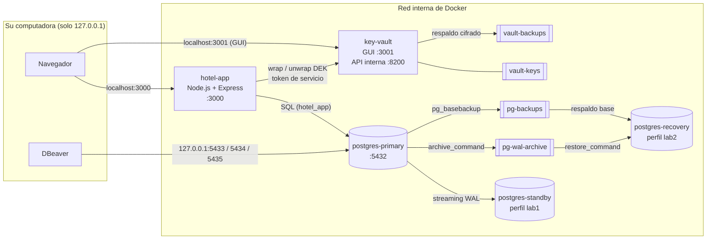
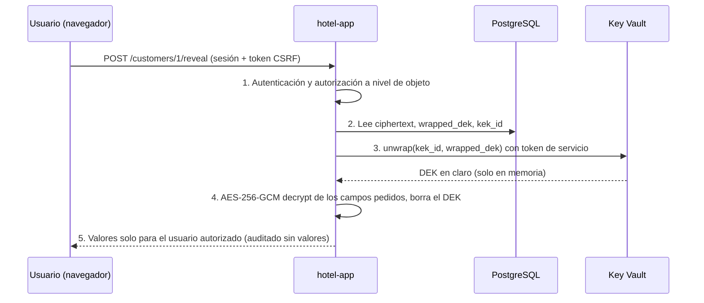
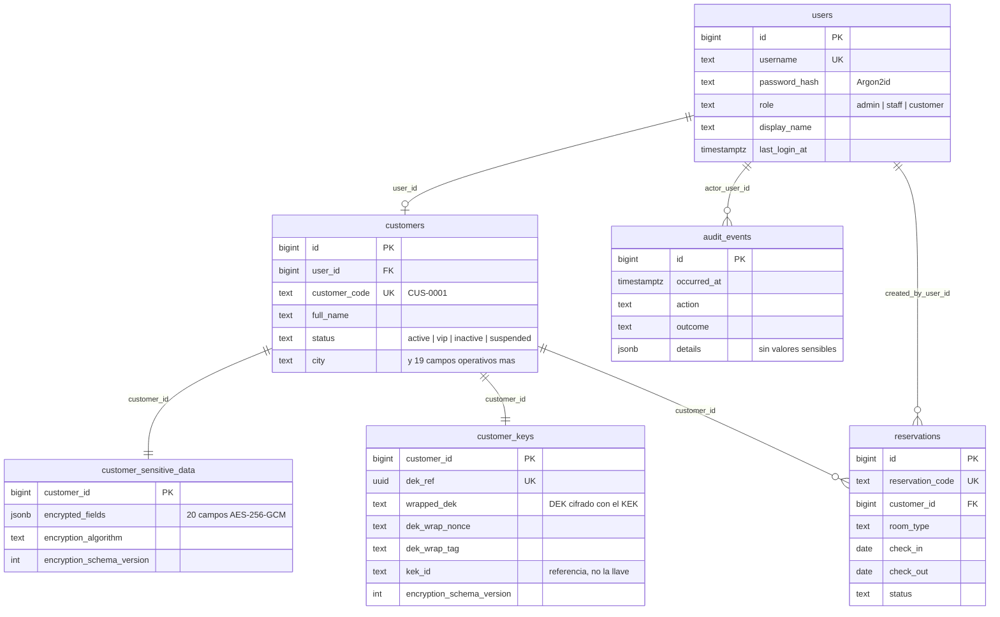
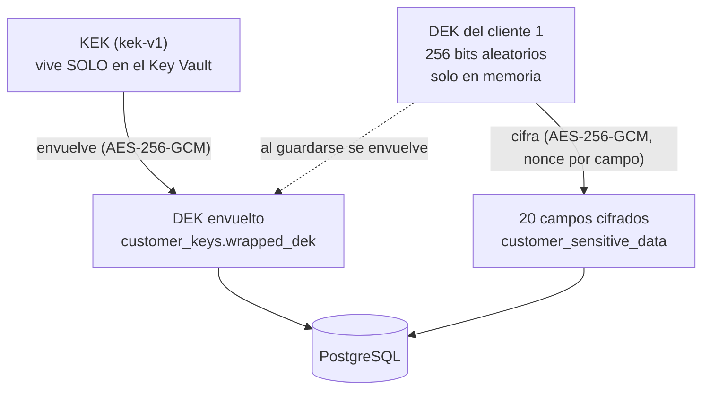

# CETYS Unidad 4: Laboratorio de alta disponibilidad y recuperación cifrada

Sistema completo de gestión hotelera para dos talleres de ciberseguridad: **alta disponibilidad con replicación física de PostgreSQL** y **recuperación ante desastres con datos cifrados (PITR + cifrado de sobre DEK/KEK)**. Todo corre localmente con Docker Compose.

Todos los datos son **ficticios**. Ningún nombre, teléfono, RFC, CLABE o tarjeta corresponde a una persona o cuenta real.

---

## Índice

1. [Descripción del proyecto](#1-descripción-del-proyecto)
2. [Objetivos de aprendizaje](#2-objetivos-de-aprendizaje)
3. [Arquitectura del sistema](#3-arquitectura-del-sistema)
4. [Requisitos y prerrequisitos](#4-requisitos-y-prerrequisitos)
5. [Estructura del repositorio](#5-estructura-del-repositorio)
6. [Imágenes y servicios de Docker](#6-imágenes-y-servicios-de-docker)
7. [Configuración inicial del entorno](#7-configuración-inicial-del-entorno)
8. [Instalación del primer arranque](#8-instalación-del-primer-arranque)
9. [Migración de la base de datos](#9-migración-de-la-base-de-datos)
10. [Generación de datos iniciales](#10-generación-de-datos-iniciales)
11. [Iniciar las aplicaciones](#11-iniciar-las-aplicaciones)
12. [URLs y cuentas de demostración](#12-urls-y-cuentas-de-demostración)
13. [Revisar los servicios de Docker](#13-revisar-los-servicios-de-docker)
14. [Inspecting PostgreSQL with DBeaver](#14-inspecting-postgresql-with-dbeaver)
15. [Explorar tablas y metadatos de cifrado](#15-explorar-tablas-y-metadatos-de-cifrado)
16. [Exploring the Hotel Management Application](#16-exploring-the-hotel-management-application)
17. [Exploring the Key Vault Application](#17-exploring-the-key-vault-application)
18. [Entender DEK y KEK](#18-entender-dek-y-kek)
19. [Laboratorio 1: alta disponibilidad y failover](#19-laboratorio-1-alta-disponibilidad-y-failover)
20. [Laboratorio 2: recuperación ante desastres y cifrado](#20-laboratorio-2-recuperación-ante-desastres-y-cifrado)
21. [Procedimientos de respaldo y PITR en PostgreSQL](#21-procedimientos-de-respaldo-y-pitr-en-postgresql)
22. [Respaldo y recuperación de llaves de cifrado](#22-respaldo-y-recuperación-de-llaves-de-cifrado)
23. [Problemas comunes y solución](#23-problemas-comunes-y-solución)
24. [Reiniciar el entorno](#24-reiniciar-el-entorno)
25. [Limpieza y restablecimiento seguros](#25-limpieza-y-restablecimiento-seguros)
26. [Notas para el instructor](#26-notas-para-el-instructor)
27. [Limitaciones de seguridad](#27-limitaciones-de-seguridad)

---

## 1. Descripción del proyecto

El repositorio contiene dos aplicaciones Node.js independientes con interfaces web Bootstrap 5:

| Aplicación | Qué hace |
|---|---|
| **Hotel Management App** (`hotel-app`) | Gestión multiusuario de clientes y reservaciones. 150 clientes ficticios, cada uno con 20 campos sensibles cifrados con AES-256-GCM y 20 campos operativos sin cifrado de aplicación. Roles de administrador, personal y cliente con autorización a nivel de objeto. Paneles de seguridad y de recuperación ante desastres. |
| **Key Vault Management App** (`key-vault`) | KMS educativo independiente. Genera, versiona y rota los KEK, envuelve y desenvuelve DEKs, respalda y restaura el almacén de llaves, y permite simular fallas. Tiene su propia cuenta de administrador. |

La infraestructura usa **PostgreSQL 17** real: replicación física por streaming, `pg_basebackup`, archivado continuo de WAL y Point-in-Time Recovery. Nada de esto se simula copiando registros.

## 2. Objetivos de aprendizaje

Al terminar los dos talleres, el estudiante podrá:

- Explicar la diferencia entre alta disponibilidad (failover) y recuperación ante desastres (respaldo + PITR).
- Verificar replicación física por streaming y medir el tiempo real de recuperación (RTO) de un failover manual.
- Promover un standby evitando split brain.
- Crear un respaldo físico, verificar el archivado de WAL y restaurar a un punto con nombre antes de un borrado accidental.
- Explicar el cifrado de sobre: por qué PostgreSQL guarda el DEK envuelto y el `kek_id` pero nunca el KEK.
- Demostrar que un respaldo de base de datos sin sus llaves no sirve para leer datos cifrados, y que las llaves deben respaldarse de forma independiente.
- Clasificar datos (sensibles frente a operativos) y observar el costo del cifrado selectivo.
- Reconocer y prevenir vulnerabilidades BOLA/IDOR con autorización en el backend.

## 3. Arquitectura del sistema



Puntos clave:

- **PostgreSQL nunca se conecta al Key Vault.** La aplicación del hotel orquesta todo el cifrado y descifrado.
- La **API criptográfica del Key Vault (8200) no se publica** al equipo anfitrión; solo la GUI (3001) en `127.0.0.1`.
- Las llaves (`vault-keys`) y sus respaldos (`vault-backups`) viven en volúmenes **separados** de los datos y respaldos de PostgreSQL.
- La aplicación del hotel elige su servidor PostgreSQL a partir del archivo compartido `/lab-control/db-target`. Los scripts de failover y PITR lo actualizan, y la aplicación se reconecta sola en unos 2 segundos.

Flujo al revelar un dato sensible:



## 4. Requisitos y prerrequisitos

| Requisito | Detalle |
|---|---|
| Docker Desktop (Windows/macOS) o Docker Engine (Linux) | Versión reciente con **Docker Compose v2** (`docker compose version`). Asigne al menos 4 GB de RAM a Docker. |
| Git | Para clonar el repositorio. |
| Bash | macOS y Linux ya lo tienen. En Windows use **WSL2** (recomendado) o **Git Bash**. |
| Navegador moderno | Chrome, Edge, Firefox o Safari. |
| DBeaver Community (opcional pero recomendado) | https://dbeaver.io/download/ |
| Puertos libres | 3000, 3001, 5433 (y 5434, 5435 para los laboratorios). |
| Disco | Unos 3 GB para imágenes, volúmenes y respaldos. |

No necesita instalar Node.js ni PostgreSQL en su computadora: todo corre dentro de contenedores. Después de construir las imágenes, las interfaces funcionan sin Internet (Bootstrap e iconos se sirven localmente).

**Windows:** clone el repositorio *dentro* de WSL2 (por ejemplo, en `~/cetys`) y ejecute todos los comandos desde la terminal de Ubuntu. Si no usa WSL2, existe `scripts/setup-env.ps1` para generar el `.env` con PowerShell; los demás scripts requieren Git Bash.

## 5. Estructura del repositorio

```text
cetys-unit4-disaster-recovery-lab/
├── README.md                     Esta guía (punto de entrada)
├── docker-compose.yml            Servicios, perfiles lab1/lab2, volúmenes, healthchecks
├── .env.example                  Contrato de configuración (copiado por setup-env.sh)
├── docker/postgres/              Imagen PostgreSQL 17 del laboratorio
│   ├── Dockerfile
│   ├── lab-entrypoint.sh         Roles primary / standby / recovery, cerco anti split brain
│   ├── archive-wal.sh            archive_command (nunca sobrescribe WAL distinto)
│   ├── lab-basebackup.sh         pg_basebackup + pg_verifybackup + catálogo
│   ├── lab-prepare-recovery.sh   Prepara la instancia de PITR
│   └── initdb/01-lab-replication.sh
├── hotel-app/                    Hotel Management App (Express + EJS + Bootstrap 5)
│   ├── migrations/               SQL versionado (001_schema.sql, 002_views.sql)
│   ├── src/
│   │   ├── server.js             Servidor web, auto-inicialización segura
│   │   ├── db.js                 Pool PostgreSQL con servidor objetivo intercambiable
│   │   ├── vaultClient.js        Cliente de la API interna del Key Vault
│   │   ├── crypto/envelope.js    AES-256-GCM por campo + cifrado de sobre
│   │   ├── policy.js             Autorización a nivel de objeto (anti BOLA/IDOR)
│   │   ├── fields.js             Clasificación: 20 sensibles + 20 operativos
│   │   ├── data/generator.js     Datos ficticios reproducibles
│   │   ├── migrate.js, seed.js   Migraciones y seed idempotentes
│   │   ├── routes/, services/    Rutas y lógica
│   │   └── cli/                  migrate.js, seed.js, verify.js
│   ├── views/                    Plantillas EJS
│   ├── public/                   CSS y JS propios
│   └── test/                     Pruebas unitarias
├── key-vault/                    Key Vault Management App
│   ├── src/store.js              Almacén de KEK, wrap/unwrap, respaldo, simulaciones
│   ├── src/api.js                API interna :8200 (token de servicio)
│   ├── src/gui.js                GUI de administración :3001
│   ├── src/cli/admin.js          CLI interna (respaldos, acceso, rotación)
│   ├── views/, public/, test/
├── scripts/                      Operación del laboratorio (ver tabla abajo)
├── docs/
│   ├── lab1-alta-disponibilidad.md
│   ├── lab2-recuperacion-cifrada.md
│   ├── guia-instructor.md
│   └── sql/consultas-dbeaver.sql
└── test-results/                 Salida de ./scripts/test-all.sh (ignorado por git)
```

| Script | Propósito |
|---|---|
| `setup-env.sh` / `setup-env.ps1` | Genera `.env` con secretos aleatorios (nunca sobrescribe sin confirmar). |
| `migrate.sh` | Crea o actualiza esquema, índices, restricciones, vistas y roles. Idempotente. |
| `seed.sh` | Crea el primer KEK (si nunca existió) y los 150 clientes. Idempotente. |
| `verify-setup.sh` | Comprobaciones PASS/FAIL de toda la instalación. |
| `start.sh [base\|lab1]` | Inicia el entorno (con standby en `lab1`). |
| `stop.sh` | Detiene contenedores sin borrar volúmenes. |
| `status.sh` | Estado de contenedores, servidor de la app, replicación, WAL, respaldos y llaves. |
| `backup.sh db\|keys\|all\|list` | Respaldo físico de PostgreSQL o respaldo independiente de KEK. |
| `restore.sh pitr\|keys` | PITR en instancia separada o restauración de KEK. |
| `lab1-failover.sh` | Promueve el standby con protección contra split brain. |
| `lab2-recovery-point.sh` | Crea un punto de restauración con nombre y fuerza su archivado. |
| `lab2-simulate-deletion.sh` | Borrado accidental simulado (solo en el laboratorio). |
| `switch-db.sh` | Cambia el servidor PostgreSQL que usa la app. |
| `reset-lab.sh lab1\|lab2\|all` | Restablecimiento controlado con confirmación explícita. |
| `test-all.sh` | Pruebas de integración completas en un proyecto Docker aislado. |

## 6. Imágenes y servicios de Docker

| Servicio | Imagen | Puerto en su equipo | Perfil | Función |
|---|---|---|---|---|
| `postgres-primary` | `cetys-dr/postgres:17` | `127.0.0.1:5433` | (siempre) | Primario con `wal_level=replica` y archivado de WAL |
| `key-vault` | `cetys-dr/key-vault:1.0` | `127.0.0.1:3001` (solo GUI) | (siempre) | KMS educativo; API interna en `key-vault:8200` |
| `hotel-app` | `cetys-dr/hotel-app:1.0` | `127.0.0.1:3000` | (siempre) | Aplicación del hotel |
| `postgres-standby` | `cetys-dr/postgres:17` | `127.0.0.1:5434` | `lab1` | Standby por streaming (pg_basebackup -R) |
| `postgres-recovery` | `cetys-dr/postgres:17` | `127.0.0.1:5435` | `lab2` | Instancia desechable de PITR |

Volúmenes con nombre (prefijo `cetys-disaster-recovery_`):

| Volumen | Contenido |
|---|---|
| `pg-primary-data` | Datos del primario |
| `pg-standby-data` | Datos del standby |
| `pg-recovery-data` | Datos de la instancia recuperada (desechable) |
| `pg-wal-archive` | WAL archivado continuamente |
| `pg-backups` | Respaldos físicos de `pg_basebackup` y su catálogo |
| `vault-keys` | Material de los KEK (`keystore.json`), estado y bitácora del Key Vault |
| `vault-backups` | Respaldos cifrados e independientes de los KEK |
| `lab-control` | Archivos de control: servidor objetivo, cerco, puntos de restauración, bitácoras |

Ningún arranque normal borra volúmenes, regenera llaves ni reinicia la base de datos.

## 7. Configuración inicial del entorno

Todas las variables están documentadas en `.env.example`. El script `./scripts/setup-env.sh`:

1. Revisa si ya existe `.env` y **no lo sobrescribe** salvo que escriba `SOBRESCRIBIR` (y guarda una copia `.env.bak-...`).
2. Copia `.env.example` y reemplaza cada `CHANGE_ME` por un secreto aleatorio local de 128 bits.
3. Deja `.env` con permisos `600`.
4. Imprime la configuración sin mostrar contraseñas ni tokens.

Variables principales:

| Variable | Valor por defecto | Uso |
|---|---|---|
| `COMPOSE_PROJECT_NAME` | `cetys-disaster-recovery` | Prefijo de contenedores y volúmenes |
| `POSTGRES_DB` | `hotel_lab` | Base de datos |
| `POSTGRES_USER` / `POSTGRES_PASSWORD` | `hotel_admin` / generado | Administrador del servidor (migraciones, scripts) |
| `POSTGRES_HOST_PORT` | `5433` | Puerto del primario en `127.0.0.1` |
| `POSTGRES_STANDBY_HOST_PORT` | `5434` | Puerto del standby |
| `POSTGRES_RECOVERY_HOST_PORT` | `5435` | Puerto de la instancia de PITR |
| `REPLICATION_USER` / `REPLICATION_PASSWORD` | `replicator` / generado | Rol de replicación física |
| `DB_HOST` / `DB_PORT` | `postgres-primary` / `5432` | Servidor inicial de la app **dentro de Docker** |
| `DB_USER` / `DB_PASSWORD` | `hotel_app` / generado | Rol de la aplicación (sin superusuario) |
| `DB_READER_USER` / `DB_READER_PASSWORD` | `lab_reader` / generado | Cuenta de solo lectura para DBeaver |
| `HOTEL_APP_PORT` / `KEY_VAULT_APP_PORT` | `3000` / `3001` | Puertos de las GUIs |
| `KEY_VAULT_URL` | `http://key-vault:8200` | API interna del Key Vault (no publicada) |
| `KEY_VAULT_SERVICE_TOKEN` | generado | Autenticación servicio a servicio |
| `HOTEL_SESSION_SECRET` / `VAULT_SESSION_SECRET` | generados | Firmas de cookies de sesión |
| `VAULT_ADMIN_USER` / `VAULT_ADMIN_PASSWORD` | `vault_admin` / `VaultAdmin2026!` | Administrador de la GUI del Key Vault |
| `VAULT_BACKUP_PASSPHRASE` | generado | Cifra los respaldos de KEK |
| `HOTEL_DEMO_*_PASSWORD` | `Admin2026!`, `Staff2026!`, `Cliente2026!` | Contraseñas de las cuentas ficticias |
| `AUTO_INIT` | `true` | La app aplica migraciones y seed **solo** si la base está vacía y sin marca |
| `LAB_MODE` | `true` | Muestra ayudas de laboratorio en las pantallas de acceso |

**Hostname dentro de Docker frente a hostname desde su computadora:**

- Los contenedores se hablan entre sí por nombre de servicio en la red interna: la app usa `postgres-primary:5432`.
- Desde su computadora (DBeaver, terminal) ese nombre no existe. Use `127.0.0.1` y el puerto publicado: `127.0.0.1:5433`.
- PostgreSQL se publica solo en `127.0.0.1`, nunca en todas las interfaces de red.

## 8. Instalación del primer arranque

Ejecute todos los comandos desde la **raíz del repositorio**.

```bash
git clone https://github.com/lccjavo/cetys-unit4-disaster-recovery-lab.git
cd cetys-unit4-disaster-recovery-lab
```

### Paso 1: construir las imágenes

```bash
docker compose build
```

Funciona aunque todavía no exista `.env` (Compose usa valores de respaldo y la construcción no requiere secretos). La primera vez tarda de 2 a 5 minutos.

### Paso 2: generar el archivo de entorno

```bash
./scripts/setup-env.sh
```

Resultado esperado: `Archivo .env generado correctamente (8 secretos aleatorios)` y un resumen de hosts, puertos y URLs. Para ver las contraseñas: `cat .env`.

### Paso 3: iniciar las dependencias de infraestructura

```bash
docker compose up -d postgres-primary key-vault
```

PostgreSQL se inicializa solo (crea la base `hotel_lab` y el rol de replicación). El Key Vault queda listo para recibir solicitudes. Compruebe que ambos digan `healthy`:

```bash
docker compose ps
```

### Paso 4: inicializar el esquema

```bash
./scripts/migrate.sh
```

Ver [sección 9](#9-migración-de-la-base-de-datos).

### Paso 5: inicializar llaves y datos

```bash
./scripts/seed.sh
```

Ver [sección 10](#10-generación-de-datos-iniciales).

### Paso 6: iniciar la aplicación completa

```bash
docker compose up -d
```

### Paso 7: verificar todo

```bash
docker compose ps
./scripts/verify-setup.sh
```

Resultado esperado al final: `RESULTADO: PASS (...)`.

**Atajo para el instructor:** en un entorno nuevo, `docker compose up -d --build` hace todo lo anterior automáticamente (la app aplica migraciones y genera los datos al detectar la base vacía). Aun así, el flujo paso a paso es el recomendado para clase porque permite observar cada etapa.

## 9. Migración de la base de datos

`./scripts/migrate.sh` ejecuta `hotel-app/src/cli/migrate.js` en un contenedor temporal con la cuenta administradora:

1. Crea o actualiza los roles `hotel_app` (aplicación) y `lab_reader` (solo lectura, `default_transaction_read_only = on`) con las contraseñas de `.env`.
2. Aplica en orden los archivos `hotel-app/migrations/NNN_*.sql` que no estén registrados en `schema_migrations`.
3. Reaplica permisos (`GRANT`) para cubrir tablas nuevas.

Es **idempotente**: ejecutarlo de nuevo muestra `Migraciones nuevas: 0` y no borra datos. Salida esperada:

```text
[migrate] Rol hotel_app: creado; rol lab_reader (solo lectura): creado
[migrate] Aplicada 001_schema.sql
[migrate] Aplicada 002_views.sql
[migrate] Migraciones nuevas: 2; ya aplicadas: 0; tablas en public: 9
OK  Migraciones completadas.
```

## 10. Generación de datos iniciales

`./scripts/seed.sh`:

1. Verifica PostgreSQL y el Key Vault.
2. Si el Key Vault **nunca** fue inicializado, crea `kek-v1` y un respaldo automático. Si ya tiene KEKs, los conserva.
3. Si el Key Vault perdió sus KEKs, **se detiene** y lo reporta: nunca genera llaves de reemplazo incompatibles.
4. Genera 150 clientes ficticios reproducibles (la misma semilla produce los mismos perfiles), 3 cuentas de personal y 304 reservaciones.
5. Para cada cliente: genera un DEK aleatorio de 256 bits, cifra los 20 campos sensibles con AES-256-GCM (nonce nuevo de 96 bits por campo), pide al Key Vault envolver el DEK y **solo entonces** hace el `INSERT`.
6. Verifica que existan exactamente 150 clientes y que los 150 se descifren con sus 20 campos.
7. Escribe la marca `lab_metadata.seed_completed_at`.

Si la marca existe (incluida una base restaurada con PITR), el seed no hace nada: `La base ya fue inicializada ... No se regenera nada.`

Datos ficticios usados:

| Dato | Formato ficticio |
|---|---|
| Teléfonos | Segmento `555` (MX) y `555-01xx` (reservado para ficción en Norteamérica) |
| Correos | Dominio reservado `.test` |
| Tarjetas | Números de **prueba** públicos (por ejemplo `4111 1111 1111 1111`); no sirven para pagar. **No se guarda CVV/CVC.** |
| RFC | Estructura de RFC con homoclave terminada en `LB` (laboratorio) |
| CLABE | 18 dígitos con código de banco `999` (inexistente) y dígito verificador calculado |
| Pasaporte / cuenta | Prefijo `LAB` |
| Menores acompañantes | Nombres inventados con la etiqueta `ficticio` |

## 11. Iniciar las aplicaciones

```bash
docker compose up -d          # entorno base: primario + Key Vault + hotel
./scripts/start.sh            # igual, esperando a que todo esté healthy
./scripts/start.sh lab1       # además el standby del laboratorio 1
```

La instancia `postgres-recovery` del laboratorio 2 la inicia `./scripts/restore.sh pitr`; no se arranca manualmente.

## 12. URLs y cuentas de demostración

| Aplicación | URL |
|---|---|
| Hotel Management | http://localhost:3000 |
| Key Vault | http://localhost:3001 |

Cuentas del hotel (todas ficticias):

| Rol | Usuario | Contraseña | Puede |
|---|---|---|---|
| Administrador | `admin@hotel-lab.test` | `Admin2026!` | Todo: directorio, revelar los 20 campos, Seguridad, Recuperación, Cuentas |
| Personal | `recepcion@hotel-lab.test` | `Staff2026!` | Directorio y reservaciones; revelar solo contacto, acompañantes y emergencia |
| Personal | `concierge@hotel-lab.test` | `Staff2026!` | Igual que recepción |
| Cliente | `cliente001@hotel-lab.test` | `Cliente2026!` | Solo su perfil (Ana Lucía Martínez Ruiz, CUS-0001) y sus reservaciones |
| Cliente | `cliente002@hotel-lab.test` ... `cliente150@hotel-lab.test` | `Cliente2026!` | Solo su propio perfil |

Cuenta del Key Vault (independiente):

| Usuario | Contraseña |
|---|---|
| `vault_admin` | `VaultAdmin2026!` (variable `VAULT_ADMIN_PASSWORD` en `.env`) |

## 13. Revisar los servicios de Docker

```bash
docker compose ps                    # estado y healthchecks
./scripts/status.sh                  # resumen del laboratorio
docker compose logs -f hotel-app     # registros de la app (Ctrl+C para salir)
docker compose logs key-vault
docker compose logs postgres-primary
```

Estado esperado en el entorno base: `postgres-primary`, `key-vault` y `hotel-app` en `Up ... (healthy)`.

## 14. Inspecting PostgreSQL with DBeaver

### Paso 1: instalar DBeaver

Descargue DBeaver Community desde https://dbeaver.io/download/ e instálelo. Puede usar cualquier otro cliente compatible con PostgreSQL (pgAdmin, DataGrip, `psql`) si lo prefiere; los datos de conexión son los mismos.

### Paso 2: crear la conexión

1. En DBeaver: **Database > New Database Connection** (o el icono del enchufe con un signo +).
2. Elija **PostgreSQL** y pulse **Next**.
3. Capture:

| Campo | Valor |
|---|---|
| Host | `127.0.0.1` |
| Port | `5433` |
| Database | `hotel_lab` |
| Authentication | Database Native |
| Username | `lab_reader` |
| Password | valor de `DB_READER_PASSWORD` en `.env` |

Para obtener la contraseña, en la raíz del repositorio ejecute:

```bash
grep DB_READER_PASSWORD .env
```

Copie todo lo que aparece después del signo `=`. (En Windows con WSL2 también puede abrir el archivo con `notepad.exe .env`.)

Recuerde: **no** use `postgres-primary` como host en DBeaver. Ese nombre solo existe dentro de la red de Docker. Desde su computadora el servidor es `127.0.0.1:5433`.

### Paso 3: probar la conexión

1. Pulse **Test Connection...**.
2. Si DBeaver pide descargar el controlador de PostgreSQL, acepte **Download**. Si no tiene Internet en ese momento, conéctese una vez para descargarlo; después ya no se necesita.
3. Debe aparecer **Connected**. Pulse **Finish**.

Si falla, compruebe que Docker y PostgreSQL estén corriendo:

```bash
docker compose ps postgres-primary
./scripts/verify-setup.sh
```

### Paso 4: navegar la base de datos

En el panel **Database Navigator**: `hotel_lab > Databases > hotel_lab > Schemas > public > Tables`. Abra (doble clic, pestaña **Data**):

| Tabla | Qué observar |
|---|---|
| `users` | Cuentas y hash Argon2id de las contraseñas |
| `customers` | Los 20 campos operativos en columnas normales |
| `customer_sensitive_data` | Columna `encrypted_fields` (JSONB) con `ciphertext`, `nonce` y `tag` por campo |
| `customer_keys` | `wrapped_dek`, `dek_wrap_nonce`, `dek_wrap_tag`, `kek_id` |
| `reservations` | Reservaciones ficticias |
| `audit_events` | Bitácora (nunca contiene valores sensibles) |

### Paso 5: ejecutar consultas SQL

Abra un editor SQL (**SQL Editor > New SQL script**, o `Ctrl+]`) y ejecute con `Ctrl+Enter`. Todas las consultas de esta sección están en `docs/sql/consultas-dbeaver.sql` y las pruebas automatizadas las ejecutan con `lab_reader`.

1. Contar usuarios:

```sql
SELECT count(*) AS total_usuarios FROM users;
SELECT role, count(*) AS usuarios FROM users GROUP BY role ORDER BY role;
```

Esperado: 153 usuarios (1 admin, 2 staff, 150 customer).

2. Listar 10 clientes:

```sql
SELECT id, customer_code, full_name, status, loyalty_tier
FROM customers
ORDER BY id
LIMIT 10;
```

3. Ciudad y país:

```sql
SELECT country, city, count(*) AS clientes
FROM customers
GROUP BY country, city
ORDER BY clientes DESC, city;
```

4. Teléfono cifrado del cliente 1:

```sql
SELECT c.id,
       c.full_name,
       s.encrypted_fields -> 'phone_number' ->> 'ciphertext' AS phone_ciphertext,
       s.encrypted_fields -> 'phone_number' ->> 'nonce'      AS phone_nonce,
       s.encrypted_fields -> 'phone_number' ->> 'tag'        AS phone_tag,
       s.encrypted_fields -> 'phone_number' ->> 'alg'        AS algoritmo
FROM customers c
JOIN customer_sensitive_data s ON s.customer_id = c.id
WHERE c.id = 1;
```

5. Campo financiero cifrado:

```sql
SELECT c.id,
       c.customer_code,
       s.encrypted_fields -> 'card_number' ->> 'ciphertext' AS card_ciphertext,
       length(decode(s.encrypted_fields -> 'card_number' ->> 'ciphertext', 'base64')) AS card_bytes,
       s.encrypted_fields -> 'clabe' ->> 'ciphertext' AS clabe_ciphertext
FROM customers c
JOIN customer_sensitive_data s ON s.customer_id = c.id
WHERE c.id = 1;
```

6. Leer el `kek_id`:

```sql
SELECT customer_id, kek_id, dek_ref
FROM customer_keys
ORDER BY customer_id
LIMIT 10;

SELECT kek_id, count(*) AS clientes
FROM customer_keys
GROUP BY kek_id
ORDER BY kek_id;
```

7. Inspeccionar un DEK envuelto:

```sql
SELECT customer_id,
       dek_ref,
       wrapped_dek,
       length(decode(wrapped_dek, 'base64')) AS wrapped_bytes,
       dek_wrap_nonce,
       dek_wrap_tag,
       kek_id,
       wrap_algorithm,
       encryption_schema_version
FROM customer_keys
WHERE customer_id = 1;
```

`wrapped_bytes` es 32: son los 256 bits del DEK, pero cifrados con el KEK.

8. Relación usuario, cliente, datos cifrados y llave:

```sql
SELECT
    u.id AS user_id,
    u.username,
    c.id AS customer_id,
    c.full_name,
    c.city,
    c.country,
    k.kek_id,
    LEFT(s.encrypted_fields -> 'phone_number' ->> 'ciphertext', 32) AS encrypted_phone_preview,
    LEFT(k.wrapped_dek, 32) AS wrapped_dek_preview
FROM users u
JOIN customers c ON c.user_id = u.id
JOIN customer_sensitive_data s ON s.customer_id = c.id
JOIN customer_keys k ON k.customer_id = c.id
ORDER BY c.id
LIMIT 10;
```

9. Contar reservaciones:

```sql
SELECT count(*) AS total_reservaciones FROM reservations;
SELECT status, count(*) AS reservaciones FROM reservations GROUP BY status ORDER BY status;
```

Esperado tras el seed: 304.

10. Ciphertext presente aunque el Key Vault no esté disponible:

```sql
SELECT count(*) AS perfiles_cifrados,
       count(*) FILTER (WHERE encrypted_fields ? 'phone_number') AS con_telefono_cifrado,
       min((SELECT count(*) FROM jsonb_object_keys(encrypted_fields))) AS campos_minimos,
       max((SELECT count(*) FROM jsonb_object_keys(encrypted_fields))) AS campos_maximos
FROM customer_sensitive_data;
```

Esperado: 150, 150, 20, 20, con el Key Vault encendido o apagado.

Consulta adicional: PostgreSQL no tiene ninguna columna con KEKs, solo la referencia `kek_id`:

```sql
SELECT table_name, column_name, data_type
FROM information_schema.columns
WHERE table_schema = 'public' AND (column_name ILIKE '%kek%' OR column_name ILIKE '%dek%')
ORDER BY table_name, column_name;
```

### Paso 6: comparar valores cifrados y descifrados

1. En DBeaver ejecute la consulta 4 y copie el inicio de `phone_ciphertext` del cliente 1.
2. En http://localhost:3000 entre como `admin@hotel-lab.test` y abra **Clientes > CUS-0001**.
3. Abra la pestaña **Información personal** y pulse **Revelar información sensible**.
4. Observe el teléfono descifrado (por ejemplo `+52 664 555 ...`). Es el mismo dato que en DBeaver solo aparece como ciphertext base64.
5. Abra la pestaña **Detalles de cifrado** e identifique el `kek_id` (por ejemplo `kek-v1`).
6. Abra http://localhost:3001, entre como `vault_admin` y vaya a **KEKs**.
7. Confirme que `kek-v1` existe, con su fecha de creación y su huella.

¿Por qué PostgreSQL guarda el DEK envuelto pero no el KEK? Si alguien roba la base de datos o un respaldo, obtiene ciphertext y DEKs envueltos, pero para abrir un DEK necesita el KEK, que vive en otro sistema con otro control de acceso. Separar la llave de los datos es el objetivo del cifrado de sobre.

### Paso 7: inspeccionar el cifrado durante una falla del Key Vault

1. Detenga el Key Vault (PostgreSQL sigue corriendo):

   ```bash
   docker compose stop key-vault
   ```

2. En DBeaver ejecute de nuevo las consultas 4 y 10: el ciphertext sigue ahí (150 perfiles, 20 campos).
3. En el hotel abra el perfil CUS-0001: los datos operativos se ven, aparece el aviso **Key Vault no disponible** y **Revelar** responde `[VAULT_UNAVAILABLE]`.
4. Restablezca el servicio y vuelva a revelar:

   ```bash
   docker compose start key-vault
   ```

## 15. Explorar tablas y metadatos de cifrado



| Tabla | Descripción |
|---|---|
| `users` | Una fila por cuenta. `role` controla el acceso. |
| `customers` | Perfil del cliente: identidad básica (`customer_code`, `full_name`, `status`) y los **20 campos operativos**. |
| `customer_sensitive_data` | Los **20 campos sensibles** cifrados. Cada clave del JSONB tiene `alg`, `v`, `nonce`, `ciphertext` y `tag`. |
| `customer_keys` | El DEK del cliente **envuelto** por el Key Vault y el `kek_id` con el que se envolvió. |
| `reservations` | Reservaciones (ID, cliente, tipo de habitación, fechas, estado). |
| `audit_events` | Bitácora: accesos, revelaciones (solo nombres de campo), intentos denegados. |
| `recovery_verifications` | Resultados del botón **Verificar recuperación**. |
| `lab_metadata` | Marca de seed (`seed_completed_at`). |
| `schema_migrations` | Migraciones aplicadas. |
| Vistas `v_customer_encryption_overview`, `v_kek_usage` | Resúmenes de metadatos de cifrado para clase. |

Los 20 campos sensibles (`encrypted_fields`): `phone_number`, `personal_email`, `home_address`, `billing_address`, `date_of_birth`, `tax_id_rfc`, `passport_number`, `card_number`, `cardholder_name`, `card_expiration`, `bank_account_number`, `clabe`, `annual_income_range`, `outstanding_balance`, `employer_name`, `company_legal_name`, `room_guests`, `accompanying_children`, `emergency_contact_name`, `emergency_contact_phone`.

Los 20 campos operativos (columnas de `customers`): `display_nickname`, `city`, `country`, `preferred_language`, `time_zone`, `preferred_currency`, `preferred_room_category`, `preferred_bed_type`, `preferred_floor`, `preferred_room_view`, `preferred_pillow_type`, `preferred_checkin_time`, `preferred_checkout_time`, `breakfast_preference`, `parking_required`, `wifi_usage_preference`, `newsletter_opt_in`, `loyalty_tier`, `preferred_contact_channel`, `favorite_amenity`.

Los campos operativos son de **menor sensibilidad para este escenario educativo**, no información pública ni datos legalmente no personales. Por eso siguen protegidos con autenticación y autorización; simplemente no usan cifrado a nivel de aplicación. Esta diferencia permite discutir clasificación de datos y el costo del cifrado (la página **Seguridad y cifrado** compara el tamaño promedio de ambos).

## 16. Exploring the Hotel Management Application

URL: **http://localhost:3000**. Entre como `admin@hotel-lab.test` / `Admin2026!`.

### Panel (Dashboard)

La página inicial muestra:

- **Usuarios totales** (153: 150 clientes + 3 de personal) y **Reservaciones** (304).
- **Perfiles cifrados** y DEKs envueltos (150).
- **KEK activo** (`kek-v1`) y estado del Key Vault.
- Tarjeta **PostgreSQL**: conectividad, servidor objetivo, `cluster_name` (`pg-primary`), rol (primario/standby), versión, timeline y `system_identifier`.
- Tarjeta **Key Vault**: conectividad, estado del almacén, versiones de KEK y acceso a llaves.
- **Actividad reciente** (bitácora de auditoría).
- **Incidentes de conexión** detectados por la app, con su duración (útil para medir el RTO).

En la barra superior, las insignias **BD** y **Key Vault** muestran el estado en todo momento.

### Clientes

1. Abra **Clientes** en la barra de navegación.
2. Busque `Martínez` (o `martinez`, la búsqueda ignora acentos) o `CUS-0001`.
3. Filtre por **País**, **Ciudad** o **Estado**; ordene pulsando los encabezados; avance con la paginación.
4. Pulse el icono del ojo para una **vista previa** o **Perfil** para abrir el detalle.
5. **Resumen** y **Preferencias** muestran los datos operativos (sin cifrado de aplicación).
6. Abra **Información personal**: los valores aparecen enmascarados (`••••••••••`).
7. Pulse **Revelar información sensible**: el servidor valida su rol, pide al Key Vault desenvolver el DEK y descifra. Verá el teléfono, correo, domicilio, RFC y pasaporte ficticios, y el KEK usado.
8. Abra **Información financiera** y revele la tarjeta de prueba, la CLABE ficticia, el ingreso y el saldo.
9. **Familia y acompañantes** muestra huéspedes y menores ficticios; **Reservaciones** muestra su historial.
10. Abra **Detalles de cifrado**: `dek_ref`, `kek_id`, DEK envuelto, nonce y etiqueta de envoltura, y una tabla con el nonce, tag y ciphertext de cada campo. Nunca se muestran DEK ni KEK en claro.

Pruebe la autorización: entre como `recepcion@hotel-lab.test` y abra CUS-0001. Personal puede revelar teléfono y correo, pero ve **Restringido para su rol** en los campos financieros. Entre como `cliente001@hotel-lab.test` e intente abrir http://localhost:3000/customers/2: recibirá **Acceso denegado (403)**, y el intento queda en la bitácora.

### Nuevo cliente

**Clientes > Nuevo cliente** agrupa los campos en pestañas. **Generar datos ficticios** llena el formulario. Al guardar, la app crea un DEK nuevo, cifra los 20 campos, envuelve el DEK con el KEK activo y redirige a **Detalles de cifrado** del cliente creado. Si el Key Vault no está disponible, el cliente **no** se guarda (nunca se almacenan datos sensibles sin cifrar).

### Reservaciones

1. Abra **Reservaciones > Nueva reservación**.
2. Elija cliente, tipo de habitación, huéspedes y fechas, y pulse **Crear reservación**.
3. Verá el mensaje `Reservación RES-00305 creada...`.
4. Confirme el cambio en DBeaver:

   ```sql
   SELECT id, reservation_code, customer_id, room_type, check_in, check_out, status
   FROM reservations ORDER BY id DESC LIMIT 5;
   ```

Las reservaciones pendientes o confirmadas se pueden cancelar (con diálogo de confirmación). Un cliente solo ve y crea reservaciones propias, aunque manipule los parámetros de la URL.

### Seguridad y cifrado (administrador)

Muestra si los campos están cifrados, DEKs únicos, estado del Key Vault, DEKs por `kek_id` comparados contra los KEK que existen en el Key Vault, parámetros criptográficos, tamaño cifrado frente a operativo y una muestra de lo que realmente guarda PostgreSQL. El botón **Re-envolver DEKs al KEK activo** migra DEKs de KEKs retirados al KEK activo sin que el DEK salga del Key Vault.

### Recuperación (administrador)

La página **Recuperación** (http://localhost:3000/dr) muestra:

- **Servidor actual de la app**, su rol (primario/standby), `cluster_name` y timeline.
- **Registros actuales** (clientes, reservaciones, usuarios).
- **Última verificación de recuperación** (botón **Verificar recuperación**: cuenta registros y descifra 10 clientes al azar).
- **Servidores PostgreSQL del laboratorio**: primario, standby y recuperación con su estado, rol, replicación (estado del receptor WAL, LSN, retraso) y el botón **Conectar la app aquí** (solo para servidores escribibles).
- **Respaldos físicos** (`pg_basebackup`) y su verificación.
- **Archivado de WAL** (`pg_stat_archiver` y archivos en `/wal-archive`).
- **Puntos de restauración** y la última recuperación PITR.
- **Tiempo de recuperación medido por la app** y **Conmutaciones (failover)**.

Active **Actualizar cada 5 s** durante las simulaciones. La página sigue funcionando aunque PostgreSQL o el Key Vault estén caídos.

### Cuentas (administrador)

Lista las 153 cuentas con su rol, prefijo del hash Argon2id y último acceso.

## 17. Exploring the Key Vault Application

URL: **http://localhost:3001**. Entre como `vault_admin` / `VaultAdmin2026!` (cuenta distinta de la del hotel). Las sesiones de esta GUI viven en memoria: si reinicia el contenedor `key-vault`, vuelva a iniciar sesión.

### Panel

Muestra la salud del almacén (`Disponible`, `Keystore ausente` o `Sin inicializar`), el **KEK activo**, el número de **versiones de KEK**, el **último respaldo**, los contadores de operaciones **wrap** y **unwrap** (y rechazadas/errores/rewrap), la disponibilidad de cada llave y el historial de rotación con eventos recientes.

### KEKs (gestión de KEK)

Tabla con `kek-v1` (y versiones posteriores): versión, algoritmo, estado **Activo** o **Retirado (solo desenvuelve)**, fecha de creación, fecha de retiro, huella SHA-256 truncada y uso. El material de llave nunca se muestra.

### Rotación

1. En **Rotación** pulse **Crear kek-v2 y activarlo** y confirme. Se genera `kek-v2`, queda activo, `kek-v1` queda retirado y se crea un respaldo automático.
2. En el hotel cree un cliente en **Clientes > Nuevo cliente** (use **Generar datos ficticios**).
3. En **Detalles de cifrado** del nuevo cliente verá `kek_id = kek-v2`.
4. Abra CUS-0001 (que usa `kek-v1`) y revele: sigue funcionando porque los KEK retirados se conservan.
5. Opcional: en **Seguridad y cifrado** pulse **Re-envolver DEKs al KEK activo** para migrar los 150 DEK a `kek-v2`.

Los KEK antiguos nunca se eliminan automáticamente.

### Disponibilidad de llaves

1. En **Simulación de desastres > Acceso a llaves** pulse **Deshabilitar acceso temporalmente**.
2. En el hotel, **Revelar** responde `[KEY_ACCESS_DISABLED]`; los datos operativos siguen visibles.
3. Pulse **Restablecer acceso** en el Key Vault.
4. Revele el mismo registro: funciona otra vez.

También puede simular **Key Vault no disponible** (la API responde 503 a todo) o detener el servicio real con `docker compose stop key-vault`.

### Respaldo y recuperación de llaves

- **Generar respaldo:** **Respaldo y recuperación > Respaldar KEKs ahora**, o `./scripts/backup.sh keys`.
- **Dónde se guarda:** volumen `cetys-disaster-recovery_vault-backups`, ruta `/vault/backups/kek-backup-<fecha>-<motivo>.json`, cifrado con AES-256-GCM y una llave derivada (scrypt) de `VAULT_BACKUP_PASSPHRASE`. Es independiente de los respaldos de PostgreSQL (`pg-backups`).
- **Simular la pérdida:** **Simulación de desastres > Pérdida del almacenamiento de KEK**, escriba `PERDER-KEYSTORE`. El archivo `keystore.json` se mueve a `/vault/keys/quarantine/` (no se destruye). El hotel muestra **KEK no encontrado**; los datos cifrados se conservan.
- **Restaurar:** en **Respaldo y recuperación** pulse **Restaurar** en el respaldo más reciente, o `./scripts/restore.sh keys latest`. Solo se agregan los KEK faltantes; un KEK existente con el mismo `kek_id` y distinto material se rechaza.
- **Verificar:** en el hotel revele CUS-0001: los datos originales vuelven a ser legibles.

En los experimentos normales no se destruyen llaves de forma permanente.

## 18. Entender DEK y KEK



| | DEK (Data Encryption Key) | KEK (Key Encryption Key) |
|---|---|---|
| Qué cifra | Los 20 campos de **un** cliente | Los DEK |
| Cuántos hay | Uno por cliente (150+) | Pocos, versionados (`kek-v1`, `kek-v2`) |
| Dónde se guarda | En PostgreSQL, **solo envuelto** | Solo en el Key Vault (`vault-keys`) |
| Quién lo ve en claro | La app, en memoria y por milisegundos | Solo el Key Vault |
| Rotación | Re-envolver sin recifrar datos | Nueva versión; las anteriores se conservan para desenvolver |

Detalles:

- Cada campo usa un **nonce nuevo de 96 bits** y una **etiqueta de 128 bits**.
- El **AAD** de cada campo es `hotel-lab|field|v1|customer:<id>|field:<nombre>`. Si se copia un ciphertext a otro cliente o a otro campo, la verificación GCM falla (`DECRYPTION_AUTH_FAILED`).
- El DEK se envuelve con AAD `kek_id + customer:<id> + dek_ref`.
- Ventaja de la rotación: cambiar el KEK solo requiere re-envolver 150 DEK de 32 bytes, no recifrar 3000 campos.
- Lección del laboratorio 2: **un respaldo de base de datos sin sus llaves es ilegible**. Las llaves también necesitan respaldo, separado y protegido.

## 19. Laboratorio 1: alta disponibilidad y failover

Guía completa paso a paso: **[docs/lab1-alta-disponibilidad.md](docs/lab1-alta-disponibilidad.md)** (100 minutos).

Resumen de comandos:

```bash
./scripts/start.sh lab1                   # primario + standby (streaming)
./scripts/status.sh                       # verificar 'pg-standby streaming'
# crear una reservación en la GUI y confirmarla en el standby (DBeaver 127.0.0.1:5434)
docker compose stop postgres-primary      # simular la caída del primario
./scripts/lab1-failover.sh                # promoción manual con protección anti split brain
./scripts/reset-lab.sh lab1               # reconstruir primario + standby al terminar
```

Este laboratorio **no** implementa failover automático ni garantiza cero pérdida de datos: la replicación es asíncrona y la promoción es una decisión manual.

## 20. Laboratorio 2: recuperación ante desastres y cifrado

Guía completa paso a paso: **[docs/lab2-recuperacion-cifrada.md](docs/lab2-recuperacion-cifrada.md)** (100 minutos).

Resumen de comandos:

```bash
./scripts/backup.sh db                    # pg_basebackup + pg_verifybackup
./scripts/status.sh                       # archivado de WAL
./scripts/lab2-recovery-point.sh antes_borrado
./scripts/lab2-simulate-deletion.sh       # borrado accidental (escriba BORRAR)
./scripts/restore.sh pitr --name antes_borrado
docker compose stop key-vault             # ciphertext presente, descifrado imposible
docker compose start key-vault
./scripts/restore.sh keys latest          # tras simular la pérdida del keystore
```

## 21. Procedimientos de respaldo y PITR en PostgreSQL

**Archivado continuo de WAL.** Los servidores corren con `wal_level=replica`, `archive_mode=on`, `archive_timeout=60` y `archive_command='/usr/local/bin/archive-wal.sh %p %f'`, que copia cada segmento a `/wal-archive` y nunca sobrescribe un archivo existente con contenido distinto. Verifique con:

```sql
SELECT archived_count, last_archived_wal, last_archived_time, failed_count FROM pg_stat_archiver;
```

**Respaldo físico.**

```bash
./scripts/backup.sh db
```

Ejecuta dentro del primario `pg_basebackup -Fp -X stream --checkpoint=fast --manifest-checksums=SHA256` hacia `/backups/base-<fecha>`, valida el resultado con `pg_verifybackup` y registra el respaldo en `/backups/catalog/`. Liste los respaldos con `./scripts/backup.sh list`.

**Punto de restauración con nombre.**

```bash
./scripts/lab2-recovery-point.sh antes_borrado
```

Ejecuta `pg_create_restore_point('antes_borrado')`, fuerza `pg_switch_wal()` y espera a que ese segmento quede archivado, para que la recuperación pueda alcanzarlo. Registra el punto en `/lab-control/restore-points.log`.

**Point-in-Time Recovery.**

```bash
./scripts/restore.sh pitr --name antes_borrado
# o por tiempo:
./scripts/restore.sh pitr --time "2026-11-23 18:30:00+00"
```

Pasos internos:

1. Elimina **solo** la instancia desechable `postgres-recovery` y su volumen de datos.
2. Elige el respaldo base verificado más reciente **anterior** al objetivo.
3. Lo copia al volumen `pg-recovery-data`, crea `recovery.signal` y configura `restore_command = 'cp /wal-archive/%f %p'`, `recovery_target_name`, `recovery_target_timeline = 'current'` y `recovery_target_action = 'promote'`.
4. Arranca `postgres-recovery` (con `archive_mode=off`, para no mezclar líneas de tiempo en el archivo compartido) y espera a que termine la recuperación.
5. Cuenta clientes y reservaciones, y cambia la app a `postgres-recovery`.

El primario original, los respaldos y el archivo WAL **no se modifican** (se montan en solo lectura en la instancia de recuperación), así que la recuperación es repetible.

## 22. Respaldo y recuperación de llaves de cifrado

| Acción | GUI (http://localhost:3001) | Terminal |
|---|---|---|
| Respaldar KEKs | Respaldo y recuperación > Respaldar KEKs ahora | `./scripts/backup.sh keys` |
| Listar respaldos | Respaldo y recuperación | `./scripts/backup.sh list` |
| Restaurar KEKs faltantes | Respaldo y recuperación > Restaurar | `./scripts/restore.sh keys latest` |
| Deshabilitar acceso | Simulación de desastres > Acceso a llaves | `docker compose exec key-vault node src/cli/admin.js access disable` |
| Restablecer acceso | Simulación de desastres > Restablecer acceso | `docker compose exec key-vault node src/cli/admin.js access enable` |
| Rotar | Rotación | `docker compose exec key-vault node src/cli/admin.js rotate` |

El Key Vault crea respaldos automáticos al inicializarse y después de cada rotación. **La restauración de PostgreSQL nunca toca los KEK**, y el Key Vault nunca genera un KEK de reemplazo si detecta que perdió sus llaves.

Advertencia: si cambia `VAULT_BACKUP_PASSPHRASE`, los respaldos anteriores ya no se pueden descifrar.

## 23. Problemas comunes y solución

| Problema | Diagnóstico | Acción recomendada |
|---|---|---|
| Docker daemon no corre | `docker info` | Abra Docker Desktop (o `sudo systemctl start docker`) y espere a que diga *running*. |
| Docker Compose no disponible | `docker compose version` | Actualice Docker Desktop o instale el plugin `docker-compose-plugin` (v2). |
| Puerto 3000 ocupado | `lsof -i :3000` (Windows: `netstat -ano \| findstr :3000`) | Cierre el otro programa o cambie `HOTEL_APP_PORT` en `.env` y ejecute `docker compose up -d`. |
| Puerto 3001 ocupado | `lsof -i :3001` | Cambie `KEY_VAULT_APP_PORT` en `.env` y `docker compose up -d`. |
| Puerto 5433 ocupado | `lsof -i :5433` | Cambie `POSTGRES_HOST_PORT` en `.env`, `docker compose up -d` y use el nuevo puerto en DBeaver. |
| Falta `.env` | `ls -la .env` | `./scripts/setup-env.sh` |
| PostgreSQL no está listo | `docker compose ps postgres-primary` y `docker compose logs --tail 50 postgres-primary` | Espere a `healthy`. Si dice `password authentication failed`, vea la fila *Autenticación*. |
| Key Vault no está listo | `docker compose logs --tail 50 key-vault` | `docker compose up -d key-vault` y espere a `healthy`. |
| Falla de autenticación (PostgreSQL) | `docker compose logs hotel-app \| grep 28P01` | El volumen se creó con otro `POSTGRES_PASSWORD` (por ejemplo, arrancó antes de generar `.env`). Ejecute `./scripts/reset-lab.sh all` (conserva las llaves). |
| Falla de autenticación (GUI) | Revise el usuario en la [sección 12](#12-urls-y-cuentas-de-demostración) | Tras 8 intentos fallidos espere 5 minutos. La contraseña del Key Vault está en `VAULT_ADMIN_PASSWORD` de `.env`. |
| DBeaver: connection refused | `docker compose ps postgres-primary` y `./scripts/verify-setup.sh` | Use host `127.0.0.1` (no `postgres-primary`, no `localhost` con IPv6) y el puerto `5433`. |
| DBeaver: contraseña incorrecta | `grep DB_READER_PASSWORD .env` | Copie el valor completo después del `=`. Si cambió `.env`, ejecute `./scripts/migrate.sh` para aplicar la contraseña al rol. |
| Faltan tablas | `./scripts/verify-setup.sh` (fila *Esquema*) | `./scripts/migrate.sh` |
| Faltan datos del seed | `./scripts/verify-setup.sh` (fila *seed*) | `./scripts/seed.sh`. Si dice que la base tiene datos sin marca, use `./scripts/reset-lab.sh all`. |
| Key Vault no disponible | Insignia roja en el hotel; `docker compose ps key-vault` | `docker compose start key-vault`; en la GUI del Key Vault revise que no esté activa la interrupción simulada ni el acceso deshabilitado. |
| KEK no encontrado | Hotel: `[KEK_NOT_FOUND]`; Key Vault: *Keystore ausente* | `./scripts/restore.sh keys latest` o restaure desde la GUI. Nunca genere un KEK nuevo para datos existentes. |
| Falla de autenticación al descifrar | Hotel: `[UNWRAP_FAILED]` o `[DECRYPTION_AUTH_FAILED]` | El KEK con ese `kek_id` tiene otro material, o el ciphertext fue alterado. Restaure el KEK original desde su respaldo; revise `audit_events`. |
| Retraso de replicación del standby | `./scripts/status.sh` (sección *Replicación*) | Espere unos segundos; revise `docker compose logs postgres-standby`. Si el standby se desconectó: `./scripts/reset-lab.sh lab1`. |
| Falla del failover | Salida de `./scripts/lab1-failover.sh` | Si dice *SPLIT BRAIN*, detenga primero el primario (`docker compose stop postgres-primary`). Si el standby no corre: `./scripts/start.sh lab1`. |
| Falta WAL en el archivo | `./scripts/status.sh` (fallidos > 0) y `docker compose logs postgres-primary \| grep archive` | Corrija la causa (espacio en disco); no borre archivos de `/wal-archive`. Cree un respaldo nuevo con `./scripts/backup.sh db`. |
| Falla del PITR | `docker compose --profile lab2 logs --tail 40 postgres-recovery` | `recovery ended before configured recovery target was reached`: el punto no existe o se creó antes del respaldo base. Cree respaldo, luego punto, y repita `./scripts/restore.sh pitr --name ...`. |
| Volumen de respaldos no disponible | `docker volume ls \| grep pg-backups` | La página Recuperación avisa *volumen no montado*. No ejecute `docker compose down -v`. Cree uno nuevo con `./scripts/backup.sh db`. |
| El primario no arranca después de un failover | `docker compose logs postgres-primary \| grep CERCADO` | Es intencional (protección anti split brain). Ejecute `./scripts/reset-lab.sh lab1`. |

## 24. Reiniciar el entorno

```bash
./scripts/stop.sh              # detener todo sin borrar datos
./scripts/start.sh             # volver a iniciar (o ./scripts/start.sh lab1)
docker compose restart hotel-app
```

Reiniciar contenedores **no** regenera usuarios, datos ni llaves: el seed solo corre con la base vacía y sin marca, y los KEK persisten en `vault-keys`. Al reiniciar la computadora, Docker vuelve a levantar los servicios (`restart: unless-stopped`).

## 25. Limpieza y restablecimiento seguros

Todas las opciones piden confirmación escrita y listan exactamente los volúmenes que se eliminan. Nunca se usa `docker system prune`.

| Comando | Elimina | Conserva |
|---|---|---|
| `./scripts/reset-lab.sh lab1` | Contenedor y volumen `pg-standby-data`; el cerco del primario | Primario, respaldos, WAL, llaves |
| `./scripts/reset-lab.sh lab2` | Contenedor y volumen `pg-recovery-data` | Primario, respaldos, WAL, llaves |
| `./scripts/reset-lab.sh all` | `pg-primary-data`, `pg-standby-data`, `pg-recovery-data`, `pg-wal-archive`, `pg-backups`, `lab-control` (y regenera los 150 clientes) | `vault-keys`, `vault-backups` |
| `./scripts/reset-lab.sh all --include-keys` | Todo lo anterior y además `vault-keys` y `vault-backups` | Nada del proyecto |

Para quitar por completo el proyecto de su equipo (borra **todos** sus datos y llaves del laboratorio):

```bash
./scripts/reset-lab.sh all --include-keys
docker compose --profile lab1 --profile lab2 down -v
```

## 26. Notas para el instructor

- Guía con agenda de 100 minutos por laboratorio: **[docs/guia-instructor.md](docs/guia-instructor.md)**.
- Antes de clase ejecute `./scripts/test-all.sh`. Corre unas 60 pruebas de integración (arranque, seed, cifrado, BOLA/IDOR, Key Vault, failover y PITR) en un proyecto Docker **aislado** (`cetys-dr-test`, puertos 13000/13001/15433-15435) y luego lo elimina; no toca el entorno de clase. El resultado queda en `test-results/ultimo-resultado.txt`.
- Entre el laboratorio 1 y el 2 ejecute `./scripts/reset-lab.sh lab1` (y, si desea empezar con 150 clientes, `./scripts/reset-lab.sh all`).
- Para repetir el laboratorio 2 desde cero: `./scripts/reset-lab.sh all` (conserva las llaves, tarda menos de un minuto).
- No se requiere entregable calificado; los puntos de control de cada guía sirven para verificar el avance.

## 27. Limitaciones de seguridad

Este es un entorno **educativo**. No lo use como base para producción sin rediseñarlo.

- El Key Vault es un **KMS simulado**: guarda los KEK en un archivo JSON dentro de un volumen Docker, sin HSM, sin cifrado del almacén con una llave maestra protegida por hardware y sin control de acceso por política.
- La comunicación hotel-app a key-vault usa HTTP dentro de la red de Docker (sin TLS ni mTLS) y un token de servicio compartido. El DEK viaja en claro por esa red interna al desenvolverse.
- Las GUIs usan HTTP en `localhost`; las cookies no tienen la bandera `Secure`. Las sesiones viven en memoria (se pierden al reiniciar el contenedor).
- Las contraseñas de demostración están documentadas y son iguales para todos los clientes ficticios.
- `hotel-app` recibe la contraseña administradora de PostgreSQL para poder aplicar migraciones al arrancar (`AUTO_INIT`). En producción las migraciones correrían en un proceso separado.
- La replicación es **asíncrona** y el failover es **manual**: puede perderse lo escrito en el primario que no alcanzó a replicarse. No hay failover automático ni consenso de clúster; el cerco anti split brain es un archivo en un volumen compartido.
- No hay limitación de tasa global ni protección contra DoS; solo un límite simple de intentos de acceso.
- Los respaldos de PostgreSQL no están cifrados en reposo (los campos sensibles sí lo están, por el cifrado de aplicación).
- Los datos operativos no se cifran a nivel de aplicación por diseño del ejercicio; en un sistema real pueden ser datos personales protegidos por la ley.
- No se procesa ningún pago real; los números de tarjeta son de prueba y no se guarda CVV/CVC.
