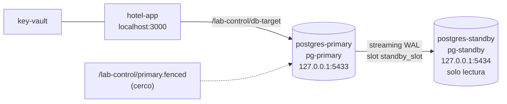
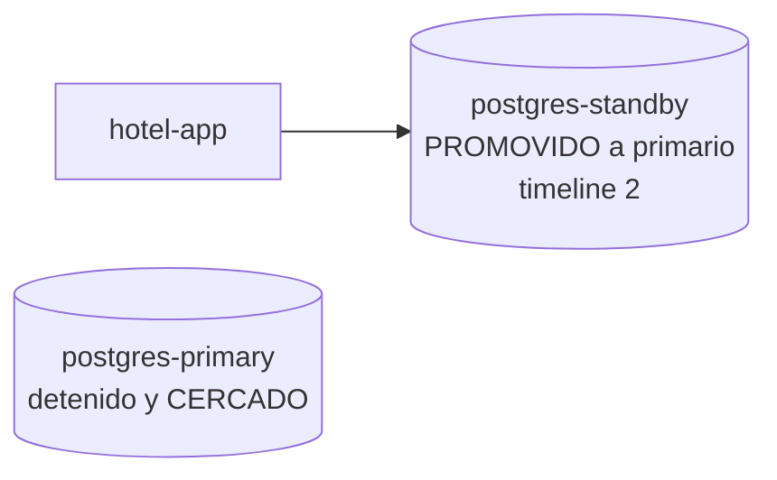

# Laboratorio 1: Alta disponibilidad y failover con PostgreSQL

**Unidad 4.1 · Duración: 100 minutos · Sin entregable calificado**

En este laboratorio usted opera una pareja real de servidores PostgreSQL 17: un **primario** y un **standby** que recibe los cambios por **replicación física por streaming**. Simulará la caída del primario, promoverá el standby de forma manual y segura, y medirá cuánto tiempo estuvo fuera de servicio la aplicación del hotel.

## Objetivos de aprendizaje

1. Distinguir un servidor primario de un standby (`pg_is_in_recovery()`).
2. Verificar que la replicación física funciona y medir su retraso.
3. Observar el comportamiento de una aplicación cuando su base de datos cae.
4. Promover un standby evitando **split brain**.
5. Comprobar que los datos cifrados siguen siendo legibles después del failover.
6. Medir el **RTO** real (tiempo de recuperación) de un failover manual.

## Prerrequisitos

- Haber completado la instalación del [README](../README.md) (secciones 8 a 12): `./scripts/verify-setup.sh` termina en `RESULTADO: PASS`.
- DBeaver configurado con la conexión al primario (README, sección 14).
- Terminal abierta en la **raíz del repositorio**.

## Arquitectura



Después del failover:



## Agenda sugerida

| Minutos | Actividad |
|---|---|
| 0 a 10 | Arranque del entorno con standby |
| 10 a 25 | Explorar el hotel y descifrar datos |
| 25 a 40 | Estado del primario y del standby en DBeaver |
| 40 a 55 | Verificar replicación con escrituras nuevas |
| 55 a 80 | Falla del primario, promoción y reconexión |
| 80 a 90 | Verificar datos cifrados y medir el RTO |
| 90 a 100 | Discusión y restablecimiento |

---

## Parte 1: Iniciar el entorno (10 min)

```bash
./scripts/start.sh lab1
```

Resultado esperado:

```text
OK  postgres-primary healthy
OK  key-vault healthy
OK  hotel-app healthy
OK  postgres-standby healthy
  Hotel Management : http://localhost:3000
  Key Vault        : http://localhost:3001
  ...
  Standby          : 127.0.0.1:5434
```

El standby se creó solo: su contenedor ejecutó `pg_basebackup -R -C -S standby_slot` contra el primario, lo que copia los datos y crea `standby.signal` con la conexión de replicación.

```bash
./scripts/status.sh
```

En la sección **Replicación** debe aparecer `pg-standby streaming async`.

**Punto de control 1:** `docker compose --profile lab1 ps` muestra los cuatro servicios `healthy` y `status.sh` muestra `streaming`.

## Parte 2: Explorar el hotel (15 min)

1. Abra http://localhost:3000 y entre como `admin@hotel-lab.test` / `Admin2026!`.
2. En el **Panel** anote: usuarios totales (153), reservaciones (304), servidor objetivo (`postgres-primary`), `cluster_name` (`pg-primary`) y rol (**Primario**).
3. Abra **Clientes**, busque `CUS-0001` y abra el perfil de Ana Lucía Martínez Ruiz.
4. En **Información personal** pulse **Revelar información sensible**. Anote el teléfono descifrado.
5. Revise otros dos clientes (por ejemplo `CUS-0002` y `CUS-0003`) y revele su **Información financiera**.
6. Abra **Recuperación** (http://localhost:3000/dr). En **Servidores PostgreSQL del laboratorio** observe:
   - `postgres-primary`: *Primario (escritura)*, con `pg-standby streaming (async)` en la columna Replicación.
   - `postgres-standby`: *Standby / en recuperación*, receptor WAL `streaming`.
7. Active **Actualizar cada 5 s**.

**Punto de control 2:** puede descifrar datos y la página Recuperación muestra el primario y el standby en línea.

## Parte 3: Primario y standby en DBeaver (15 min)

Cree una **segunda conexión** en DBeaver para el standby (igual que la del primario, pero con puerto **5434**):

| Campo | Primario | Standby |
|---|---|---|
| Host | `127.0.0.1` | `127.0.0.1` |
| Port | `5433` | `5434` |
| Database | `hotel_lab` | `hotel_lab` |
| Usuario | `lab_reader` | `lab_reader` |
| Contraseña | `DB_READER_PASSWORD` de `.env` | la misma |

Ejecute en **cada** conexión:

```sql
SELECT current_setting('cluster_name') AS servidor,
       pg_is_in_recovery() AS es_standby,
       (SELECT timeline_id FROM pg_control_checkpoint()) AS timeline;
```

| Servidor | Esperado |
|---|---|
| Primario (5433) | `pg-primary`, `false`, timeline 1 |
| Standby (5434) | `pg-standby`, `true`, timeline 1 |

En el **primario**, vea la replicación:

```sql
SELECT application_name, client_addr, state, sync_state, replay_lsn
FROM pg_stat_replication;
```

Esperado: una fila `pg-standby | ... | streaming | async`.

En el **standby**, vea el receptor y el retraso:

```sql
SELECT status, sender_host FROM pg_stat_wal_receiver;
SELECT pg_last_wal_replay_lsn() AS replay_lsn,
       now() - pg_last_xact_replay_timestamp() AS retraso_desde_ultima_transaccion;
```

Pregunta: ¿por qué `sync_state` es `async`? ¿Qué implica para la pérdida de datos si el primario falla?

**Punto de control 3:** identifica cuál servidor es primario y cuál standby solo con SQL.

## Parte 4: Verificar la replicación (15 min)

1. En el hotel cree una reservación: **Reservaciones > Nueva reservación**, cliente `CUS-0003`, *Suite Junior*, 2 huéspedes, fechas futuras. Anote el código (por ejemplo `RES-00305`).
2. Cree un cliente nuevo: **Clientes > Nuevo cliente > Generar datos ficticios > Cifrar y guardar cliente**. Anote su código (por ejemplo `CUS-0151`).
3. En DBeaver, conexión **standby (5434)**:

   ```sql
   SELECT reservation_code, customer_id, room_type, check_in, status
   FROM reservations ORDER BY id DESC LIMIT 3;

   SELECT c.customer_code, c.full_name, k.kek_id,
          LEFT(s.encrypted_fields -> 'phone_number' ->> 'ciphertext', 24) AS telefono_cifrado
   FROM customers c
   JOIN customer_keys k ON k.customer_id = c.id
   JOIN customer_sensitive_data s ON s.customer_id = c.id
   ORDER BY c.id DESC LIMIT 3;
   ```

   Ambos registros aparecen en el standby en menos de un segundo. El cliente nuevo llega **ya cifrado**: la replicación copia bytes de WAL, no valores en claro.

4. Intente escribir en el standby. Desde la terminal (con la cuenta administradora):

   ```bash
   docker compose exec -T -u postgres postgres-standby sh -c 'psql -U "$POSTGRES_USER" -d "$POSTGRES_DB" -c "INSERT INTO lab_metadata VALUES (\$\$x\$\$, \$\$y\$\$)"'
   ```

   Resultado esperado: `ERROR: cannot execute INSERT in a read-only transaction`.

**Punto de control 4:** sus registros nuevos aparecen en el standby y el standby rechaza escrituras.

## Parte 5: Falla del primario y promoción (25 min)

### 5.1 Intente promover con el primario vivo

```bash
./scripts/lab1-failover.sh
```

Resultado esperado:

```text
ERROR postgres-primary sigue aceptando conexiones. Promover ahora crearia SPLIT BRAIN.
       Detengalo primero:  docker compose stop postgres-primary
```

**Split brain** significa tener dos servidores que aceptan escrituras al mismo tiempo, cada uno con una historia distinta de los datos. El script lo impide.

### 5.2 Simule la caída

Anote la hora y detenga el primario:

```bash
date
docker compose stop postgres-primary
```

Observe el hotel (recargue la página):

- Aparece la alerta roja **Base de datos no disponible** y la insignia **BD** se pone roja.
- **Clientes** muestra la página *Base de datos no disponible* (HTTP 503), pero el servidor web **sigue en línea** y su sesión no se pierde.
- En **Recuperación**, `postgres-primary` aparece *Sin respuesta* y se registra un incidente *en curso*.

Pregunta: ¿qué partes de la aplicación siguen funcionando y por qué?

### 5.3 Promueva el standby

```bash
./scripts/lab1-failover.sh
```

Qué hace el script:

1. Comprueba que el primario **no** acepte conexiones.
2. **Cerca** al primario original escribiendo `/lab-control/primary.fenced`. Su contenedor se negará a arrancar como primario.
3. Ejecuta `SELECT pg_promote(true, 60)` en el standby y espera a que `pg_is_in_recovery()` sea `false`.
4. Escribe `postgres-standby` en `/lab-control/db-target`; la app se reconecta sola en unos 2 segundos.
5. Mide el tiempo desde que se detuvo el primario hasta que la app se reconectó.

Resultado esperado (los segundos varían):

```text
OK  postgres-standby es el nuevo primario (timeline 2) en 1 s
OK  La aplicacion del hotel ya usa postgres-standby
    Promocion: 1 s
    Tiempo total desde que se detuvo el primario hasta la reconexion (RTO medido): 48 s
```

El RTO incluye el tiempo que usted tardó en decidir y ejecutar la promoción: en un failover manual, la persona es parte del tiempo de recuperación.

### 5.4 Compruebe el cerco

```bash
docker compose up -d postgres-primary
docker compose logs --tail 8 postgres-primary
```

Esperado: `ESTE NODO FUE CERCADO (fenced) DURANTE UNA CONMUTACION POR ERROR.` El contenedor queda en ejecución pero PostgreSQL **no** arranca. Así, aunque alguien reinicie todo con `docker compose up -d`, no aparecen dos primarios.

**Punto de control 5:** la app usa `postgres-standby` y el primario original permanece cercado.

## Parte 6: Verificar datos y medir el RTO (10 min)

1. En el **Panel** del hotel: servidor objetivo `postgres-standby`, `cluster_name` `pg-standby`, rol **Primario**, timeline 2.
2. Confirme que los conteos son los mismos que antes de la falla (incluidos su reservación y su cliente nuevo).
3. Abra `CUS-0001` y revele su información personal: el teléfono es el mismo que anotó en la parte 2. El Key Vault no cambió; solo cambió el servidor de base de datos.
4. Cree otra reservación: el nuevo primario acepta escrituras.
5. En **Recuperación** revise **Tiempo de recuperación medido por la app** y **Conmutaciones (failover)**.
6. En DBeaver, conexión 5434:

   ```sql
   SELECT current_setting('cluster_name') AS servidor, pg_is_in_recovery() AS es_standby,
          (SELECT timeline_id FROM pg_control_checkpoint()) AS timeline;
   SELECT count(*) FROM customers;
   SELECT count(*) FROM reservations;
   ```

   Esperado: `pg-standby`, `false`, timeline 2.

Registre sus mediciones:

| Medición | Valor |
|---|---|
| Hora de la caída | |
| Duración de la promoción (script) | |
| RTO medido por el script | |
| Duración del incidente según la app (Recuperación) | |
| ¿Se perdió algún registro? | |

**Punto de control 6:** datos y cifrado intactos después del failover y RTO registrado.

## Parte 7: Discusión y restablecimiento (10 min)

Preguntas para discutir:

1. ¿Por qué la replicación asíncrona puede perder transacciones recientes? ¿Qué cambiaría con `synchronous_commit` y un standby síncrono?
2. ¿Qué pasaría si se promoviera el standby sin cercar el primario y luego el primario volviera?
3. ¿Qué parte del RTO fue técnica y qué parte fue humana? ¿Cómo se reduciría con failover automático (y qué riesgos agrega)?
4. ¿Por qué la replicación **no** sustituye a los respaldos? (Pista: un `DELETE` accidental también se replica. Lo verá en el laboratorio 2.)

Restablezca el laboratorio:

```bash
./scripts/reset-lab.sh lab1
```

Escriba `RECONSTRUIR`. El script elimina el standby, retira el cerco, devuelve la app a `postgres-primary` y clona un standby nuevo. Lo escrito en el standby después de la promoción se descarta.

## Problemas comunes

| Síntoma | Diagnóstico | Solución |
|---|---|---|
| `postgres-standby no esta en ejecucion` | `docker compose --profile lab1 ps` | `./scripts/start.sh lab1` |
| El standby no llega a `healthy` | `docker compose logs postgres-standby` | Si ve errores de autenticación de `replicator`, ejecute `./scripts/reset-lab.sh all` (el volumen se creó con otro `.env`). |
| `status.sh` no muestra `streaming` | `docker compose logs --tail 30 postgres-standby` | `./scripts/reset-lab.sh lab1` |
| La app no se reconecta tras el failover | `curl -s http://localhost:3000/health` | `./scripts/switch-db.sh postgres-standby` o el botón **Conectar la app aquí** en Recuperación. |
| El primario no arranca | `docker compose logs postgres-primary \| grep CERCADO` | Es el cerco; `./scripts/reset-lab.sh lab1`. |
| DBeaver no conecta al 5434 | `docker compose --profile lab1 ps postgres-standby` | Inicie el standby; use `127.0.0.1` y puerto `5434`. |

## Restablecimiento seguro

- `./scripts/reset-lab.sh lab1`: reconstruye primario y standby (conserva respaldos y llaves).
- `./scripts/stop.sh`: detiene todo sin borrar datos.
- Para volver a los 150 clientes iniciales: `./scripts/reset-lab.sh all` (conserva las llaves).
