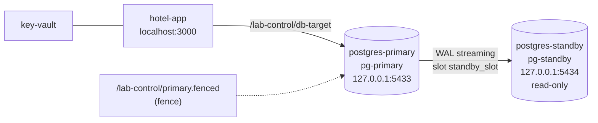
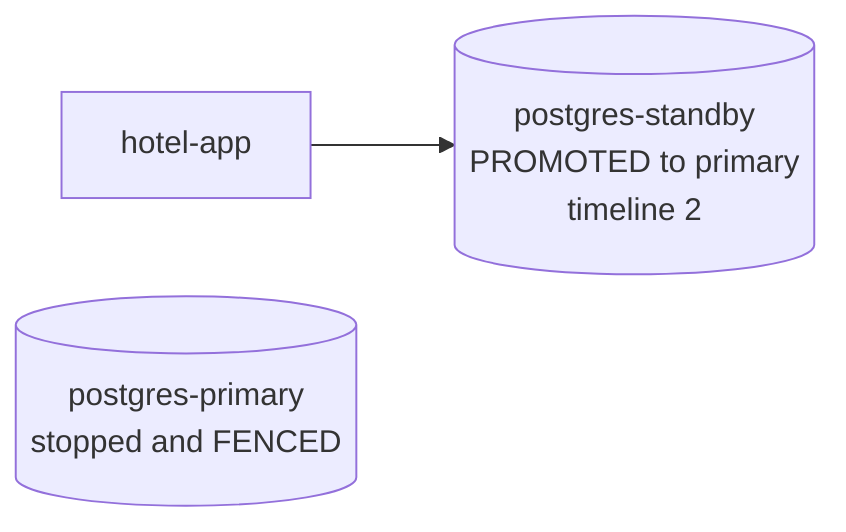

# Lab 1: PostgreSQL High Availability and Failover

**Unit 4.1 · Duration: 100 minutes · No graded deliverable**

In this lab you operate a real pair of PostgreSQL 17 servers: a **primary** and a **standby** that receives changes through **physical streaming replication**. You will simulate a primary failure, promote the standby manually and safely, and measure how long the hotel application was out of service.

## Learning objectives

1. Tell a primary server apart from a standby (`pg_is_in_recovery()`).
2. Verify that physical replication works and measure its lag.
3. Observe how an application behaves when its database goes down.
4. Promote a standby while preventing **split brain**.
5. Confirm that encrypted data is still readable after the failover.
6. Measure the real **RTO** (recovery time) of a manual failover.

## Prerequisites

- You completed the installation in the [README](../README.md) (sections 8 to 12): `./scripts/verify-setup.sh` ends with `RESULT: PASS`.
- DBeaver configured with the connection to the primary (README, section 14).
- A terminal open at the **repository root**.

## Architecture



After the failover:



## Suggested schedule

| Minutes | Activity |
|---|---|
| 0 to 10 | Start the environment with the standby |
| 10 to 25 | Explore the hotel app and decrypt data |
| 25 to 40 | Primary and standby status in DBeaver |
| 40 to 55 | Verify replication with new writes |
| 55 to 80 | Primary failure, promotion and reconnection |
| 80 to 90 | Verify encrypted data and measure the RTO |
| 90 to 100 | Discussion and reset |

---

## Part 1: Start the environment (10 min)

```bash
./scripts/start.sh lab1
```

Expected result:

```text
OK  postgres-primary healthy
OK  key-vault healthy
OK  hotel-app healthy
OK  postgres-standby healthy
  Hotel Management : http://localhost:3000
  Key Vault        : http://localhost:3001
  ...
  Standby          : 127.0.0.1:5434
```

The standby set itself up: its container ran `pg_basebackup -R -C -S standby_slot` against the primary, which copies the data and creates `standby.signal` with the replication connection.

```bash
./scripts/status.sh
```

The **Replication** section must show `pg-standby streaming async lag_bytes=0`.

**Checkpoint 1:** `docker compose --profile lab1 ps` shows all four services `healthy`, and `status.sh` shows `streaming`.

## Part 2: Explore the hotel app (15 min)

1. Open http://localhost:3000 and sign in as `admin@hotel-lab.test` / `Admin2026!`.
2. On the **Dashboard** note: total users (153), reservations (304), target server (`postgres-primary`), `cluster_name` (`pg-primary`) and role (**Primary**).
3. Open **Customers**, search for `CUS-0001` and open Ana Lucía Martínez Ruiz's profile.
4. On **Personal information** click **Reveal sensitive information**. Write down the decrypted phone number.
5. Look at two more customers (for example `CUS-0002` and `CUS-0003`) and reveal their **Financial information**.
6. Open **Recovery** (http://localhost:3000/dr). Under **Lab PostgreSQL servers** look at:
   - `postgres-primary`: *Primary (writable)*, with `pg-standby streaming (async)` in the Replication column.
   - `postgres-standby`: *Standby / in recovery*, WAL receiver `streaming`.
7. Turn on **Refresh every 5 s**.

**Checkpoint 2:** you can decrypt data, and the Recovery page shows both the primary and the standby online.

## Part 3: Primary and standby in DBeaver (15 min)

Create a **second connection** in DBeaver for the standby (same as the primary one, but with port **5434**):

| Field | Primary | Standby |
|---|---|---|
| Host | `127.0.0.1` | `127.0.0.1` |
| Port | `5433` | `5434` |
| Database | `hotel_lab` | `hotel_lab` |
| User | `lab_reader` | `lab_reader` |
| Password | `DB_READER_PASSWORD` from `.env` | the same |

Run on **each** connection:

```sql
SELECT current_setting('cluster_name') AS server,
       pg_is_in_recovery() AS is_standby,
       (SELECT timeline_id FROM pg_control_checkpoint()) AS timeline;
```

| Server | Expected |
|---|---|
| Primary (5433) | `pg-primary`, `false`, timeline 1 |
| Standby (5434) | `pg-standby`, `true`, timeline 1 |

On the **primary**, look at replication:

```sql
SELECT application_name, client_addr, state, sync_state, replay_lsn
FROM pg_stat_replication;
```

Expected: one row `pg-standby | ... | streaming | async`.

On the **standby**, look at the receiver and the lag:

```sql
SELECT status, sender_host FROM pg_stat_wal_receiver;
SELECT pg_last_wal_replay_lsn() AS replay_lsn,
       now() - pg_last_xact_replay_timestamp() AS delay_since_last_transaction;
```

Question: why is `sync_state` `async`? What does that mean for data loss if the primary fails?

**Checkpoint 3:** you can tell which server is the primary and which is the standby using SQL alone.

## Part 4: Verify replication (15 min)

1. In the hotel app create a reservation: **Reservations > New reservation**, customer `CUS-0003`, *Junior Suite*, 2 guests, future dates. Write down the code (for example `RES-00305`).
2. Create a new customer: **Customers > New customer > Generate fictional data > Encrypt and save customer**. Write down its code (for example `CUS-0151`).
3. In DBeaver, on the **standby (5434)** connection:

   ```sql
   SELECT reservation_code, customer_id, room_type, check_in, status
   FROM reservations ORDER BY id DESC LIMIT 3;

   SELECT c.customer_code, c.full_name, k.kek_id,
          LEFT(s.encrypted_fields -> 'phone_number' ->> 'ciphertext', 24) AS encrypted_phone
   FROM customers c
   JOIN customer_keys k ON k.customer_id = c.id
   JOIN customer_sensitive_data s ON s.customer_id = c.id
   ORDER BY c.id DESC LIMIT 3;
   ```

   Both records appear on the standby in under a second. The new customer arrives **already encrypted**: replication copies WAL bytes, not plaintext values.

4. Try writing to the standby. From the terminal (with the administrator account):

   ```bash
   docker compose exec -T -u postgres postgres-standby sh -c 'psql -U "$POSTGRES_USER" -d "$POSTGRES_DB" -c "INSERT INTO lab_metadata VALUES (\$\$x\$\$, \$\$y\$\$)"'
   ```

   Expected result: `ERROR: cannot execute INSERT in a read-only transaction`.

**Checkpoint 4:** your new records appear on the standby, and the standby rejects writes.

## Part 5: Primary failure and promotion (25 min)

### 5.1 Try to promote while the primary is alive

```bash
./scripts/lab1-failover.sh
```

Expected result:

```text
ERROR postgres-primary is still accepting connections. Promoting now would cause SPLIT BRAIN.
       Stop it first:  docker compose stop postgres-primary
```

**Split brain** means two servers accepting writes at the same time, each with a different history of the data. The script prevents it.

### 5.2 Simulate the failure

Note the time and stop the primary:

```bash
date
docker compose stop postgres-primary
```

Watch the hotel app (reload the page):

- The red **Database unavailable** alert appears and the **DB** badge turns red.
- **Customers** shows the *Database unavailable* page (HTTP 503), but the web server **stays online** and your session is not lost.
- On **Recovery**, `postgres-primary` shows *Not responding* and an *ongoing* incident is recorded.

Question: which parts of the application keep working, and why?

### 5.3 Promote the standby

```bash
./scripts/lab1-failover.sh
```

What the script does:

1. Checks that the primary is **not** accepting connections.
2. **Fences** the original primary by writing `/lab-control/primary.fenced`. Its container will refuse to start as a primary.
3. Runs `SELECT pg_promote(true, 60)` on the standby and waits until `pg_is_in_recovery()` is `false`.
4. Writes `postgres-standby` to `/lab-control/db-target`; the app reconnects on its own in about 2 seconds.
5. Measures the time from the primary stop until the app reconnected.

Expected result (the seconds vary):

```text
OK  postgres-standby is the new primary (timeline 2) after 1 s
OK  The hotel application now uses postgres-standby
    Promotion: 1 s
    Total time from primary stop to application reconnect (measured RTO): 48 s
```

The RTO includes the time you took to decide and run the promotion: in a manual failover, the person is part of the recovery time.

### 5.4 Check the fence

```bash
docker compose up -d postgres-primary
docker compose logs --tail 8 postgres-primary
```

Expected: `THIS NODE WAS FENCED DURING A FAILOVER.` The container keeps running but PostgreSQL does **not** start. So even if someone restarts everything with `docker compose up -d`, two primaries never appear.

**Checkpoint 5:** the app uses `postgres-standby` and the original primary stays fenced.

## Part 6: Verify the data and measure the RTO (10 min)

1. On the hotel **Dashboard**: target server `postgres-standby`, `cluster_name` `pg-standby`, role **Primary**, timeline 2.
2. Confirm the counts match the ones before the failure (including your reservation and your new customer).
3. Open `CUS-0001` and reveal the personal information: the phone number is the same one you wrote down in Part 2. The Key Vault did not change; only the database server did.
4. Create another reservation: the new primary accepts writes.
5. On **Recovery** check **Recovery time measured by the app** and **Failovers**.
6. In DBeaver, on the 5434 connection:

   ```sql
   SELECT current_setting('cluster_name') AS server, pg_is_in_recovery() AS is_standby,
          (SELECT timeline_id FROM pg_control_checkpoint()) AS timeline;
   SELECT count(*) FROM customers;
   SELECT count(*) FROM reservations;
   ```

   Expected: `pg-standby`, `false`, timeline 2.

Record your measurements:

| Measurement | Value |
|---|---|
| Time of the failure | |
| Promotion duration (script) | |
| RTO measured by the script | |
| Incident duration according to the app (Recovery) | |
| Was any record lost? | |

**Checkpoint 6:** data and encryption are intact after the failover, and the RTO is recorded.

## Part 7: Discussion and reset (10 min)

Discussion questions:

1. Why can asynchronous replication lose recent transactions? What would change with `synchronous_commit` and a synchronous standby?
2. What would happen if the standby were promoted without fencing the primary, and then the primary came back?
3. Which part of the RTO was technical and which part was human? How would automatic failover reduce it (and what risks does it add)?
4. Why does replication **not** replace backups? (Hint: an accidental `DELETE` is replicated too. You will see this in Lab 2.)

Reset the lab:

```bash
./scripts/reset-lab.sh lab1
```

Type `REBUILD`. The script removes the standby, removes the fence, returns the app to `postgres-primary` and clones a new standby. Anything written to the standby after the promotion is discarded.

## Troubleshooting

| Symptom | Diagnostic | Fix |
|---|---|---|
| `postgres-standby is not running` | `docker compose --profile lab1 ps` | `./scripts/start.sh lab1` |
| The standby never becomes `healthy` | `docker compose logs postgres-standby` | If you see `replicator` authentication errors, run `./scripts/reset-lab.sh all` (the volume was created with another `.env`). |
| `status.sh` does not show `streaming` | `docker compose logs --tail 30 postgres-standby` | `./scripts/reset-lab.sh lab1` |
| The app does not reconnect after the failover | `curl -s http://localhost:3000/health` | `./scripts/switch-db.sh postgres-standby`, or the **Connect the app here** button on Recovery. |
| The primary does not start | `docker compose logs postgres-primary \| grep FENCED` | That is the fence; `./scripts/reset-lab.sh lab1`. |
| DBeaver cannot connect to 5434 | `docker compose --profile lab1 ps postgres-standby` | Start the standby; use `127.0.0.1` and port `5434`. |

## Safe reset

- `./scripts/reset-lab.sh lab1`: rebuilds the primary and the standby (keeps backups and keys).
- `./scripts/stop.sh`: stops everything without deleting data.
- To return to the initial 150 customers: `./scripts/reset-lab.sh all` (keeps the keys).
