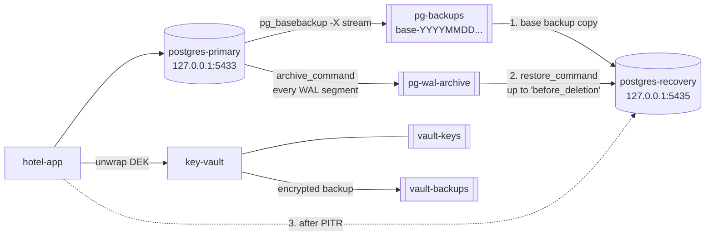

# Lab 2: PostgreSQL Disaster Recovery with Encrypted Data

**Unit 4.3 · Duration: 100 minutes · No graded deliverable**

An operator runs a `DELETE` with an incomplete condition by mistake and wipes out more than a hundred customers. Replication does not help (the deletion is replicated too). You will recover the database to a **point in time before the deletion** using a **physical backup** and the **archived WAL**. Then you will see the other half of the lesson: the recovered data is encrypted, and without the **Key Vault** and its **KEKs** it is unreadable.

## Learning objectives

1. Tell encrypted data (ciphertext) apart from operational data directly in PostgreSQL.
2. Create a physical backup with `pg_basebackup` and validate it with `pg_verifybackup`.
3. Verify continuous WAL archiving.
4. Create a named restore point.
5. Run a Point-in-Time Recovery (PITR) that restores exactly the state before the deletion.
6. Show that key availability is part of recovery.
7. Recover a KEK from an independent backup.

## Prerequisites

- Complete installation from the [README](../README.md): `./scripts/verify-setup.sh` ends with `RESULT: PASS`.
- An environment with 150 customers. If you already did Lab 1 or experimented with the data, start clean:

  ```bash
  ./scripts/reset-lab.sh all
  ```

  (Type `RESET`. It keeps the keys and takes under a minute.)
- DBeaver connected to `127.0.0.1:5433` as `lab_reader` (README, section 14).

## Architecture



Exercise timeline:

```text
 base backup ── new customer ── point 'before_deletion' ── accidental DELETE ── PITR
      |               |                   |                        |             |
   Part 3          Part 4              Part 4                   Part 5        Part 6
                              (this is where we want to return) <────────────────┘
```

## Suggested schedule

| Minutes | Activity |
|---|---|
| 0 to 10 | Verify the environment with 150 customers |
| 10 to 25 | Inspect ciphertext and KEKs in DBeaver and in the hotel app |
| 25 to 40 | Physical backup and WAL archiving |
| 40 to 50 | New data and a restore point |
| 50 to 60 | Accidental deletion |
| 60 to 75 | PITR and verification |
| 75 to 90 | Key Vault disabled and KEK recovery |
| 90 to 100 | Discussion |

---

## Part 1: Verify the environment (10 min)

```bash
./scripts/start.sh
./scripts/verify-setup.sh
```

Expected: `PASS  Fictional seed customers = 150` and `RESULT: PASS`.

In DBeaver (5433):

```sql
SELECT count(*) AS customers FROM customers;
SELECT count(*) AS reservations FROM reservations;
SELECT country, count(*) FROM customers GROUP BY country ORDER BY 2 DESC;
```

Expected: 150 customers, 304 reservations, 104 of them in Mexico.

**Checkpoint 1:** 150 customers and verification in PASS.

## Part 2: Inspect encrypted and non-encrypted fields (15 min)

In DBeaver compare an operational value with an encrypted one for customer 1:

```sql
SELECT c.id, c.full_name, c.city, c.preferred_room_category, c.loyalty_tier,
       s.encrypted_fields -> 'phone_number' ->> 'ciphertext' AS encrypted_phone,
       s.encrypted_fields -> 'card_number'  ->> 'ciphertext' AS encrypted_card,
       k.kek_id,
       LEFT(k.wrapped_dek, 32) AS wrapped_dek
FROM customers c
JOIN customer_sensitive_data s ON s.customer_id = c.id
JOIN customer_keys k ON k.customer_id = c.id
WHERE c.id = 1;
```

Notice that `city` and `loyalty_tier` are readable directly, while the phone and the card are meaningless base64.

Confirm that PostgreSQL holds no KEK:

```sql
SELECT table_name, column_name
FROM information_schema.columns
WHERE table_schema = 'public' AND (column_name ILIKE '%kek%' OR column_name ILIKE '%dek%')
ORDER BY 1, 2;
```

Only `kek_id` (a reference) and the columns of the **wrapped** DEK appear.

In the hotel app (http://localhost:3000, `admin@hotel-lab.test` / `Admin2026!`):

1. Open `CUS-0001` > **Personal information** > **Reveal sensitive information**. Write down the phone number.
2. **Encryption details** tab: compare `wrapped_dek` and the `phone_number` nonce/ciphertext with what you saw in DBeaver.
3. In the Key Vault (http://localhost:3001, `vault_admin` / `VaultAdmin2026!`) open **KEKs** and confirm that `kek-v1` exists. Open **Backup and recovery**: an automatic backup was already created at initialization.

**Checkpoint 2:** you can explain which value is in plaintext, which is encrypted, and where each key lives.

## Part 3: Physical backup and WAL archiving (15 min)

### 3.1 Base backup

```bash
./scripts/backup.sh db
```

Expected result (abridged):

```text
==> Physical backup of postgres-primary with pg_basebackup (includes the required WAL, -X stream)
    Starting pg_basebackup of pg-primary into /backups/base-20261123T190501Z
    Verifying the backup with pg_verifybackup
    backup successfully verified
    BACKUP=base-20261123T190501Z
    VERIFIED=true
OK  Base backup created and verified: base-20261123T190501Z
```

`pg_basebackup` copies the cluster's physical files while it stays in service; `-X stream` includes the WAL needed for a consistent copy, and `pg_verifybackup` checks the SHA-256 checksums in the manifest.

### 3.2 WAL archiving

```bash
./scripts/status.sh
```

Under **WAL archiving** you should see `archive_mode=on`, `archived` greater than 0 and `failed=0`. In DBeaver:

```sql
SELECT archived_count, last_archived_wal, last_archived_time, failed_count
FROM pg_stat_archiver;
```

In the hotel app open **Recovery**: the backup appears (with *pg_verifybackup OK*) along with the segments in `/wal-archive`.

Question: a base backup is a snapshot of one instant. What does the archived WAL add?

**Checkpoint 3:** a verified backup and WAL being archived with no failures.

## Part 4: New data and a restore point (10 min)

1. In the hotel app create a customer: **Customers > New customer > Generate fictional data > Encrypt and save customer**. Write down its code (for example `CUS-0151`). This customer is **not** in the base backup: it only exists in the WAL.
2. Create a reservation for that customer.
3. Create the restore point:

   ```bash
   ./scripts/lab2-recovery-point.sh before_deletion
   ```

   Expected:

   ```text
   ==> Restore point 'before_deletion' created at LSN 0/6025A98 (state: 151 customers, 305 reservations). Waiting for ... to be archived...
   OK  Restore point 'before_deletion' is ready and archived (WAL ...).
   ```

   Write down the counts: this is the state you must recover.

**Checkpoint 4:** restore point `before_deletion` created with 151 customers.

## Part 5: Accidental deletion (10 min)

```bash
./scripts/lab2-simulate-deletion.sh
```

The script describes the scenario (the operator meant to delete one customer but ran `... WHERE country = 'Mexico'`) and asks you to type `DELETE`. Expected result:

```text
OK  Deletion simulated at ...
    Before: 151 customers / 305 reservations
    After:  46 customers / 92 reservations
```

Observe the loss:

- Hotel app: the **Dashboard** and **Customers** show 46 customers; filtering by Country *Mexico* returns no results.
- DBeaver: `SELECT count(*) FROM customers;` returns 46. The reservations, encrypted data and wrapped DEKs of those customers were deleted too (cascading foreign keys).

Question: if there were a standby as in Lab 1, would it still have the deleted customers?

**Checkpoint 5:** the application shows 46 customers.

## Part 6: Point-in-Time Recovery (15 min)

```bash
./scripts/restore.sh pitr --name before_deletion
```

What it does:

1. Cleans only the disposable `postgres-recovery` instance.
2. Copies the verified base backup taken before the `before_deletion` point.
3. Sets `restore_command`, `recovery_target_name = 'before_deletion'`, `recovery_target_timeline = 'current'` and `recovery_target_action = 'promote'`.
4. Starts the instance, which replays the archived WAL and stops exactly at the point.
5. Switches the hotel app to `postgres-recovery`.

Expected result:

```text
    ... starting point-in-time recovery to "before_deletion"
    ... recovery stopping at restore point "before_deletion", time ...
    ... archive recovery complete
OK  PITR completed in 1 s: 151 customers and 305 reservations on postgres-recovery
OK  The hotel application now uses postgres-recovery (it reconnects in ~2 s).
```

Verify in DBeaver with a **new connection** to port **5435** (same details as the 5433 one):

```sql
SELECT current_setting('cluster_name') AS server, pg_is_in_recovery() AS is_standby;
SELECT count(*) AS customers FROM customers;
SELECT count(*) AS reservations FROM reservations;
SELECT count(*) AS customers_in_mexico FROM customers WHERE country = 'Mexico';
SELECT customer_code, full_name, created_at FROM customers ORDER BY id DESC LIMIT 3;
```

Expected: `pg-recovery`, `false`, 151, 305, 104, and your new customer (which only existed in the WAL) is present.

Compare with the original primary (5433): it still has 46 customers. The recovery did **not** overwrite the primary or the backups.

In the hotel app:

1. The **Dashboard** shows server `postgres-recovery` and 151 customers.
2. Open `CUS-0001` and reveal the personal information: it is the same phone number you wrote down in Part 2.
3. Open your new customer and reveal the financial information.
4. On **Recovery** click **Verify recovery**: `success`, with 10 of 10 sample customers decrypted.

**Checkpoint 6:** 151 customers recovered and decryptable.

## Part 7: The Key Vault and KEK recovery (15 min)

### 7.1 Key Vault unavailable

```bash
docker compose stop key-vault
```

- DBeaver (5435): the ciphertext is still there.

  ```sql
  SELECT count(*) AS encrypted_profiles,
         count(*) FILTER (WHERE encrypted_fields ? 'phone_number') AS with_encrypted_phone
  FROM customer_sensitive_data;
  ```

- Hotel app: the database works (directory, preferences, reservations), but **Key Vault unavailable** appears and **Reveal** answers `[VAULT_UNAVAILABLE]`. The ciphertext is never displayed as if it were text.

```bash
docker compose start key-vault
```

Reveal again: it works. (If the Key Vault GUI asks you to sign in again, that is expected: its sessions live in memory.)

### 7.2 KEK storage loss

1. In the Key Vault open **Disaster simulation > KEK storage loss**, click **Simulate KEK loss** and type `LOSE-KEYSTORE`.
2. The Key Vault dashboard shows **Keystore missing**. The hotel app shows **KEK not found** and **Reveal** answers `[KEK_NOT_FOUND]`.
3. Think about it: the database is perfectly recovered, but its sensitive data is useless without the KEK. The Key Vault does **not** generate a new `kek-v1`, because it would be incompatible with the existing wrapped DEKs.
4. Restore the KEK from the independent backup:

   ```bash
   ./scripts/restore.sh keys latest
   ```

   Or in the GUI: **Backup and recovery > Restore** on the most recent backup.
5. In the hotel app reveal `CUS-0001` again: the original data is readable again.

**Checkpoint 7:** you showed that without the KEK there is no data, and that the independent key backup restores access.

## Part 8: Discussion (10 min)

1. Why must the key backup be separate from the database backup? What happens if both are in the same place and someone steals it?
2. What happens if **both** are lost: the KEK and its backup?
3. What is the RPO in this exercise? What data would have been lost if the restore point had been created five minutes earlier?
4. Why recover into a separate instance instead of overwriting the primary?
5. What would change if the KEK were rotated after the last key backup? (Hint: the Key Vault backs up automatically after every rotation.)

## Troubleshooting

| Symptom | Diagnostic | Fix |
|---|---|---|
| `No base backup exists` when creating the point | `./scripts/backup.sh list` | Run `./scripts/backup.sh db` before the restore point. |
| `There are no customers from 'Mexico'` | The deletion was already simulated | `./scripts/reset-lab.sh all` to start again. |
| PITR: `recovery ended before configured recovery target was reached` | `docker compose --profile lab2 logs --tail 40 postgres-recovery` | The point is not in the archived WAL or predates the backup. Order: backup, then point, then deletion. |
| PITR: `there is no verified base backup taken before the recovery target` | `./scripts/backup.sh list` | Create a new backup and a new point. |
| DBeaver cannot connect to 5435 | `docker compose --profile lab2 ps postgres-recovery` | Run `./scripts/restore.sh pitr ...` first. |
| The app still shows 46 customers | `curl -s http://localhost:3000/health` | `./scripts/switch-db.sh postgres-recovery`, or **Connect the app here** on Recovery. |
| `KEK_NOT_FOUND` after restoring keys | `./scripts/backup.sh list` | Restore a backup that includes the `kek_id` the customers use (see **Security and encryption**). |
| `BACKUP_DECRYPT_FAILED` | `VAULT_BACKUP_PASSPHRASE` was changed | Use the original `.env` (or its `.env.bak-...` copy). |

## Safe reset

- `./scripts/reset-lab.sh lab2`: removes the recovery instance and returns the app to the primary (which keeps the deletion).
- `./scripts/reset-lab.sh all`: a fresh database with 150 customers; it **keeps** the keys and their backups.
- Backups and WAL are never deleted by a normal startup.
