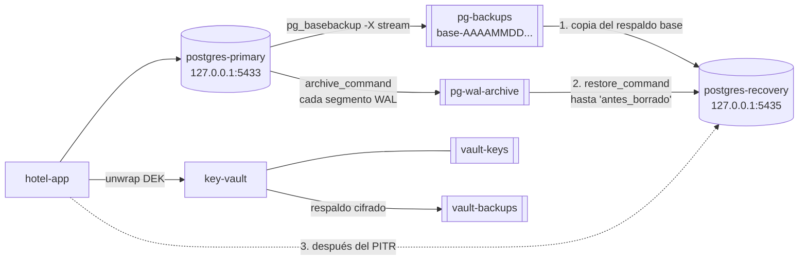

# Laboratorio 2: Recuperación ante desastres de PostgreSQL con datos cifrados

**Unidad 4.3 · Duración: 100 minutos · Sin entregable calificado**

Un operador ejecuta por error un `DELETE` con una condición incompleta y borra más de cien clientes. La replicación no ayuda (el borrado también se replica). Usted recuperará la base a un **punto en el tiempo anterior al borrado** usando un **respaldo físico** y el **WAL archivado**. Después comprobará la otra mitad de la lección: los datos recuperados están cifrados, y sin el **Key Vault** y sus **KEK** son ilegibles.

## Objetivos de aprendizaje

1. Distinguir datos cifrados (ciphertext) de datos operativos directamente en PostgreSQL.
2. Crear un respaldo físico con `pg_basebackup` y validarlo con `pg_verifybackup`.
3. Verificar el archivado continuo de WAL.
4. Crear un punto de restauración con nombre.
5. Ejecutar un Point-in-Time Recovery (PITR) que restaure exactamente el estado previo al borrado.
6. Demostrar que la disponibilidad de las llaves es parte de la recuperación.
7. Recuperar un KEK desde un respaldo independiente.

## Prerrequisitos

- Instalación completa del [README](../README.md): `./scripts/verify-setup.sh` termina en `RESULTADO: PASS`.
- Entorno con 150 clientes. Si ya hizo el laboratorio 1 o experimentó con los datos, empiece limpio:

  ```bash
  ./scripts/reset-lab.sh all
  ```

  (Escriba `REINICIAR`. Conserva las llaves; tarda menos de un minuto.)
- DBeaver conectado a `127.0.0.1:5433` con `lab_reader` (README, sección 14).

## Arquitectura



Línea de tiempo del ejercicio:

```text
 respaldo base ── cliente nuevo ── punto 'antes_borrado' ── DELETE accidental ── PITR
      |                |                    |                       |              |
   Parte 3          Parte 4              Parte 4                 Parte 5        Parte 6
                                 (aquí queremos volver) <───────────────────────┘
```

## Agenda sugerida

| Minutos | Actividad |
|---|---|
| 0 a 10 | Verificar el entorno con 150 clientes |
| 10 a 25 | Inspeccionar ciphertext y KEK en DBeaver y en el hotel |
| 25 a 40 | Respaldo físico y archivado de WAL |
| 40 a 50 | Datos nuevos y punto de restauración |
| 50 a 60 | Borrado accidental |
| 60 a 75 | PITR y verificación |
| 75 a 90 | Key Vault deshabilitado y recuperación del KEK |
| 90 a 100 | Discusión |

---

## Parte 1: Verificar el entorno (10 min)

```bash
./scripts/start.sh
./scripts/verify-setup.sh
```

Esperado: `PASS  Clientes ficticios del seed = 150` y `RESULTADO: PASS`.

En DBeaver (5433):

```sql
SELECT count(*) AS clientes FROM customers;
SELECT count(*) AS reservaciones FROM reservations;
SELECT country, count(*) FROM customers GROUP BY country ORDER BY 2 DESC;
```

Esperado: 150 clientes, 304 reservaciones, 104 de ellos en México.

**Punto de control 1:** 150 clientes y verificación en PASS.

## Parte 2: Inspeccionar campos cifrados y no cifrados (15 min)

En DBeaver compare un dato operativo con uno cifrado del cliente 1:

```sql
SELECT c.id, c.full_name, c.city, c.preferred_room_category, c.loyalty_tier,
       s.encrypted_fields -> 'phone_number' ->> 'ciphertext' AS telefono_cifrado,
       s.encrypted_fields -> 'card_number'  ->> 'ciphertext' AS tarjeta_cifrada,
       k.kek_id,
       LEFT(k.wrapped_dek, 32) AS dek_envuelto
FROM customers c
JOIN customer_sensitive_data s ON s.customer_id = c.id
JOIN customer_keys k ON k.customer_id = c.id
WHERE c.id = 1;
```

Observe que `city` y `loyalty_tier` se leen directamente, mientras que el teléfono y la tarjeta son base64 sin significado.

Confirme que PostgreSQL no tiene ninguna llave KEK:

```sql
SELECT table_name, column_name
FROM information_schema.columns
WHERE table_schema = 'public' AND (column_name ILIKE '%kek%' OR column_name ILIKE '%dek%')
ORDER BY 1, 2;
```

Solo aparecen `kek_id` (una referencia) y las columnas del DEK **envuelto**.

En el hotel (http://localhost:3000, `admin@hotel-lab.test` / `Admin2026!`):

1. Abra `CUS-0001` > **Información personal** > **Revelar información sensible**. Anote el teléfono.
2. Pestaña **Detalles de cifrado**: compare `wrapped_dek` y el nonce/ciphertext de `phone_number` con lo que vio en DBeaver.
3. En el Key Vault (http://localhost:3001, `vault_admin` / `VaultAdmin2026!`) abra **KEKs** y confirme que existe `kek-v1`. Abra **Respaldo y recuperación**: ya existe un respaldo automático creado al inicializar.

**Punto de control 2:** puede explicar qué dato está en claro, cuál cifrado y dónde vive cada llave.

## Parte 3: Respaldo físico y archivado de WAL (15 min)

### 3.1 Respaldo base

```bash
./scripts/backup.sh db
```

Resultado esperado (resumido):

```text
==> Respaldo fisico de postgres-primary con pg_basebackup (incluye el WAL necesario, -X stream)
    Iniciando pg_basebackup de pg-primary hacia /backups/base-20261123T190501Z
    Verificando el respaldo con pg_verifybackup
    backup successfully verified
    RESPALDO=base-20261123T190501Z
    VERIFICADO=true
OK  Respaldo base creado y verificado: base-20261123T190501Z
```

`pg_basebackup` copia los archivos físicos del clúster mientras sigue en servicio; `-X stream` incluye el WAL necesario para que la copia sea consistente, y `pg_verifybackup` comprueba las sumas SHA-256 del manifiesto.

### 3.2 Archivado de WAL

```bash
./scripts/status.sh
```

En **Archivado de WAL** debe ver `archive_mode=on`, `archivados` mayor que 0 y `fallidos=0`. En DBeaver:

```sql
SELECT archived_count, last_archived_wal, last_archived_time, failed_count
FROM pg_stat_archiver;
```

En el hotel abra **Recuperación**: aparecen el respaldo (con *pg_verifybackup OK*) y los segmentos en `/wal-archive`.

Pregunta: un respaldo base es una foto de un instante. ¿Qué aporta el WAL archivado?

**Punto de control 3:** respaldo verificado y WAL archivándose sin fallas.

## Parte 4: Datos nuevos y punto de restauración (10 min)

1. En el hotel cree un cliente: **Clientes > Nuevo cliente > Generar datos ficticios > Cifrar y guardar cliente**. Anote su código (por ejemplo `CUS-0151`). Este cliente **no** está en el respaldo base: solo existe en el WAL.
2. Cree una reservación para ese cliente.
3. Cree el punto de restauración:

   ```bash
   ./scripts/lab2-recovery-point.sh antes_borrado
   ```

   Esperado:

   ```text
   ==> Punto 'antes_borrado' creado en LSN 0/5000108 (estado: 151 clientes, 305 reservaciones). Esperando el archivado de ...
   OK  Punto de restauracion 'antes_borrado' listo y archivado (WAL ...).
   ```

   Anote los conteos: es el estado que debe recuperar.

**Punto de control 4:** punto `antes_borrado` creado con 151 clientes.

## Parte 5: Borrado accidental (10 min)

```bash
./scripts/lab2-simulate-deletion.sh
```

El script muestra el escenario (el operador quería borrar un solo cliente pero ejecutó `... WHERE country = 'México'`) y pide escribir `BORRAR`. Resultado esperado:

```text
OK  Borrado simulado a las ...
    Antes:   151 clientes / 305 reservaciones
    Despues: 46 clientes / 92 reservaciones
```

Observe la pérdida:

- Hotel: el **Panel** y **Clientes** muestran 46 clientes; filtrar por País *México* no devuelve resultados.
- DBeaver: `SELECT count(*) FROM customers;` devuelve 46. Las reservaciones, los datos cifrados y los DEK envueltos de esos clientes también se borraron (claves foráneas en cascada).

Pregunta: si hubiera un standby como en el laboratorio 1, ¿tendría los clientes borrados?

**Punto de control 5:** la aplicación muestra 46 clientes.

## Parte 6: Point-in-Time Recovery (15 min)

```bash
./scripts/restore.sh pitr --name antes_borrado
```

Qué hace:

1. Limpia solo la instancia desechable `postgres-recovery`.
2. Copia el respaldo base verificado anterior al punto `antes_borrado`.
3. Configura `restore_command`, `recovery_target_name = 'antes_borrado'`, `recovery_target_timeline = 'current'` y `recovery_target_action = 'promote'`.
4. Arranca la instancia, que reproduce el WAL archivado y se detiene exactamente en el punto.
5. Cambia la app del hotel a `postgres-recovery`.

Resultado esperado:

```text
    ... starting point-in-time recovery to "antes_borrado"
    ... recovery stopping at restore point "antes_borrado", time ...
    ... archive recovery complete
OK  PITR completado en 1 s: 151 clientes y 305 reservaciones en postgres-recovery
OK  La aplicacion del hotel ahora usa postgres-recovery (se reconecta en ~2 s).
```

Verifique en DBeaver con una **nueva conexión** al puerto **5435** (mismos datos que la del 5433):

```sql
SELECT current_setting('cluster_name') AS servidor, pg_is_in_recovery() AS es_standby;
SELECT count(*) AS clientes FROM customers;
SELECT count(*) AS reservaciones FROM reservations;
SELECT count(*) AS clientes_mexico FROM customers WHERE country = 'México';
SELECT customer_code, full_name, created_at FROM customers ORDER BY id DESC LIMIT 3;
```

Esperado: `pg-recovery`, `false`, 151, 305, 104, y su cliente nuevo (que solo estaba en el WAL) presente.

Compare con el primario original (5433): sigue con 46 clientes. La recuperación **no** sobrescribió el primario ni los respaldos.

En el hotel:

1. El **Panel** indica servidor `postgres-recovery` y 151 clientes.
2. Abra `CUS-0001` y revele su información personal: es el mismo teléfono que anotó en la parte 2.
3. Abra su cliente nuevo y revele su información financiera.
4. En **Recuperación** pulse **Verificar recuperación**: `success`, con 10 de 10 clientes de muestra descifrados.

**Punto de control 6:** 151 clientes recuperados y descifrables.

## Parte 7: Key Vault y recuperación del KEK (15 min)

### 7.1 Key Vault no disponible

```bash
docker compose stop key-vault
```

- DBeaver (5435): el ciphertext sigue ahí.

  ```sql
  SELECT count(*) AS perfiles_cifrados,
         count(*) FILTER (WHERE encrypted_fields ? 'phone_number') AS con_telefono_cifrado
  FROM customer_sensitive_data;
  ```

- Hotel: la base funciona (directorio, preferencias, reservaciones), pero aparece **Key Vault no disponible** y **Revelar** responde `[VAULT_UNAVAILABLE]`. El ciphertext nunca se muestra como si fuera texto.

```bash
docker compose start key-vault
```

Revele de nuevo: funciona. (Si la GUI del Key Vault le pide iniciar sesión otra vez es normal: sus sesiones viven en memoria.)

### 7.2 Pérdida del almacenamiento de KEK

1. En el Key Vault abra **Simulación de desastres > Pérdida del almacenamiento de KEK**, pulse **Simular pérdida de KEKs** y escriba `PERDER-KEYSTORE`.
2. El panel del Key Vault muestra **Keystore ausente**. En el hotel aparece **KEK no encontrado** y **Revelar** responde `[KEK_NOT_FOUND]`.
3. Reflexione: la base de datos está perfectamente recuperada, pero sus datos sensibles son inservibles sin el KEK. El Key Vault **no** genera un `kek-v1` nuevo, porque sería incompatible con los DEK envueltos existentes.
4. Restaure el KEK desde el respaldo independiente:

   ```bash
   ./scripts/restore.sh keys latest
   ```

   O en la GUI: **Respaldo y recuperación > Restaurar** en el respaldo más reciente.
5. En el hotel revele `CUS-0001` otra vez: los datos originales vuelven a ser legibles.

**Punto de control 7:** comprobó que sin KEK no hay datos, y que el respaldo independiente de llaves restaura el acceso.

## Parte 8: Discusión (10 min)

1. ¿Por qué el respaldo de llaves debe estar separado del respaldo de la base de datos? ¿Qué pasa si ambos están en el mismo lugar y alguien lo roba?
2. ¿Qué pasa si se pierden **ambos**: el KEK y su respaldo?
3. ¿Qué es el RPO de este ejercicio? ¿Qué datos se habrían perdido si el punto de restauración se hubiera creado cinco minutos antes?
4. ¿Por qué recuperar en una instancia separada en lugar de sobrescribir el primario?
5. ¿Qué cambiaría si se rotara el KEK después del último respaldo de llaves? (Pista: el Key Vault respalda automáticamente después de cada rotación.)

## Problemas comunes

| Síntoma | Diagnóstico | Solución |
|---|---|---|
| `No existe ningun respaldo base` al crear el punto | `./scripts/backup.sh list` | Ejecute `./scripts/backup.sh db` antes del punto de restauración. |
| `No hay clientes de 'México'` | El borrado ya se simuló | `./scripts/reset-lab.sh all` para empezar de nuevo. |
| PITR: `recovery ended before configured recovery target was reached` | `docker compose --profile lab2 logs --tail 40 postgres-recovery` | El punto no está en el WAL archivado o es anterior al respaldo. Respaldo, luego punto, luego borrado. |
| PITR: `no hay un respaldo base verificado anterior al objetivo` | `./scripts/backup.sh list` | Cree un respaldo y un punto nuevos. |
| DBeaver no conecta al 5435 | `docker compose --profile lab2 ps postgres-recovery` | Ejecute primero `./scripts/restore.sh pitr ...`. |
| La app sigue mostrando 46 clientes | `curl -s http://localhost:3000/health` | `./scripts/switch-db.sh postgres-recovery` o **Conectar la app aquí** en Recuperación. |
| `KEK_NOT_FOUND` después de restaurar llaves | `./scripts/backup.sh list` | Restaure un respaldo que incluya el `kek_id` que usan los clientes (vea **Seguridad y cifrado**). |
| `BACKUP_DECRYPT_FAILED` | Se cambió `VAULT_BACKUP_PASSPHRASE` | Use el `.env` original (o su copia `.env.bak-...`). |

## Restablecimiento seguro

- `./scripts/reset-lab.sh lab2`: elimina la instancia de recuperación y devuelve la app al primario (que conserva el borrado).
- `./scripts/reset-lab.sh all`: base nueva con 150 clientes; **conserva** las llaves y sus respaldos.
- Los respaldos y el WAL nunca se borran en un arranque normal.
